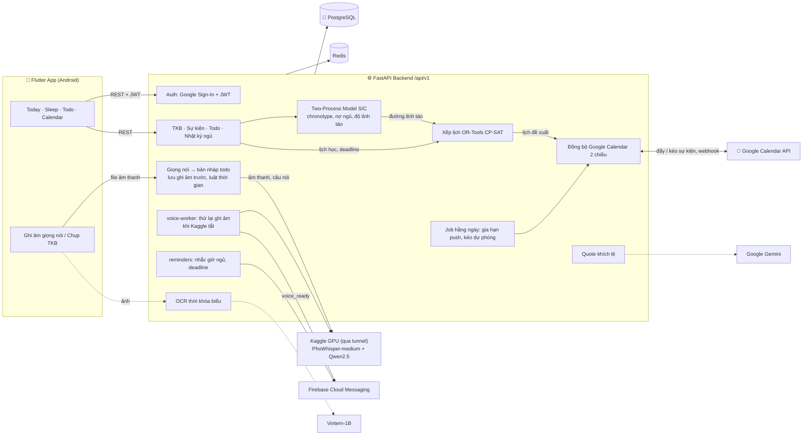

<div align="center">

# 🌿 RECOLLY

**Điều hòa lịch trình sinh hoạt cho sinh viên – cân bằng giữa học tập và nghỉ ngơi**

   -000000?logo=ollama&logoColor=white)  

</div>

---

## 📑 Mục lục

- [Giới thiệu](#-giới-thiệu)
- [Vấn đề & mục tiêu](#-vấn-đề--mục-tiêu)
- [Tính năng chính](#-tính-năng-chính)
- [Công nghệ sử dụng](#-công-nghệ-sử-dụng)
- [Kiến trúc hệ thống](#-kiến-trúc-hệ-thống)
- [Lộ trình triển khai](#-lộ-trình-triển-khai)
- [Cài đặt & chạy thử](#-cài-đặt--chạy-thử)
- [Theo dõi log & demo](#-theo-dõi-log--demo)
- [Thành viên nhóm](#-thành-viên-nhóm)
- [Giấy phép](#-giấy-phép)

---

## 📖 Giới thiệu

**Recolly** là ứng dụng di động giúp sinh viên tự động xếp lịch học, ôn thi và thời gian nghỉ ngơi theo **nhịp sinh học cá nhân**.

Người dùng chỉ cần chụp ảnh thời khóa biểu; Recolly trích xuất dữ liệu, ước tính mức tỉnh táo trong ngày, tự xếp giờ ôn thi – giờ nghỉ vào các khung giờ phù hợp và đưa lên Google Calendar.

**Đối tượng:** sinh viên học theo hệ tín chỉ.

---

## 🎯 Vấn đề & mục tiêu

### Vấn đề

- Học theo tín chỉ nên thời khóa biểu **thay đổi mỗi kỳ**; sinh viên thường phải **nhập thủ công** vào Google Calendar vì phần mềm của trường không đồng bộ được.
- Phải tự quản lý lịch sinh hoạt, lịch ôn thi và giờ ngủ.
- Khi lịch học dày, **giấc ngủ là thứ bị hy sinh đầu tiên** mà không có công cụ nào cảnh báo.

### Mục tiêu

1. Chụp ảnh thời khóa biểu → nhận lại lịch đã được chuẩn hóa.
2. Ước tính **nợ giấc ngủ** và **mức tỉnh táo** trong ngày bằng [mô hình hai quá trình điều hòa giấc ngủ của Borbély](https://www.chronobiology.ch/wp-content/uploads/2019/05/BorbélyJSR2016.pdf).
3. Tự xếp giờ ôn thi và giờ nghỉ vào khung giờ phù hợp, rồi đẩy lên Google Calendar.

---

## ✨ Tính năng chính

### 🗓️ Module 1: Đồng bộ lịch trình
Tích hợp Google Calendar để đồng bộ thời khóa biểu và các sự kiện.

### 😴 Module 2: Chronotype & nợ ngủ
- Từ giờ ngủ ngày học và ngày nghỉ, xếp người dùng vào 1 trong 3 nhóm: 🦁 Sư tử, 🐻 Gấu, 🐺 Sói. Các nhóm này chỉ giúp dễ hiển thị, không phải chẩn đoán.
- Tính nợ ngủ 7 ngày gần nhất: `max(0, tổng của (số giờ cần ngủ − số giờ ngủ thật))`.
- Ước lượng mức tỉnh táo trong ngày bằng **Two-Process Model of Sleep Regulation** (Process S – áp lực ngủ, Process C – nhịp sinh học) của Borbély để làm cơ sở xếp lịch.

### 🔔 Module 3: Giao diện trực quan, nhắc nhở & động lực
- Nhắc giờ ngủ và các deadline sắp tới.
- Thông báo tiến độ học tập kèm các câu quote khích lệ sinh viên.

### 📸 Module 4: Nhập thời khóa biểu & lời nhắc nhanh
- Tải ảnh thời khóa biểu → hệ thống tự trích xuất và tạo lịch (OCR tiếng Việt với [Vintern-1B-v3_5](https://huggingface.co/5CD-AI/Vintern-1B-v3_5)).
- Nhập lời nhắc bằng giọng nói tiếng Việt (PhoWhisper).

---

## 🛠️ Công nghệ sử dụng

| Thành phần | Công nghệ |
|---|---|
| Mobile | Flutter |
| Backend | FastAPI (Python) |
| Cơ sở dữ liệu | PostgreSQL |
| Lịch | Google Calendar API (OAuth 2.0) |
| Xếp lịch tối ưu | OR-Tools CP-SAT |
| Nhận diện văn bản (OCR) | Vintern-1B-v3_5 |
| Nhận diện giọng nói (ASR) | [PhoWhisper-medium](https://huggingface.co/vinai/PhoWhisper-medium) trên GPU Kaggle |
| LLM | Qwen2.5 chạy qua [Ollama](https://ollama.com) trên GPU Kaggle (giọng nói → todo); Google Gemini (dự kiến, cho quote) |
| Thông báo đẩy | Firebase Cloud Messaging (HTTP v1) |
| Hạ tầng | Docker Compose, Redis (rate limit, chống gửi trùng), Cloudflare quick tunnel, [Dozzle](https://dozzle.dev) (xem log) |

PhoWhisper và Qwen2.5 chạy trên GPU của Kaggle (notebook `server/notebooks/kaggle_ollama.ipynb`); server gọi qua tunnel
Cloudflare, nên máy chạy server không cần GPU hay `torch`. Vintern và Gemini chưa được tích hợp.

---

## 🏗️ Kiến trúc hệ thống



Nét đứt là phần chưa tích hợp. Hợp đồng API nằm ở [`docs/openapi.yaml`](docs/openapi.yaml).

---

## 🗺️ Lộ trình triển khai

Bảng dưới đây chỉ nói về backend.

### Giai đoạn 1 – Lõi hệ thống

| Tính năng | Backend |
|---|---|
| Xếp 3 con vật, đường năng lượng trong ngày | Đã có: `/chronotype/assess`, `/biorhythm` |
| Nhật ký ngủ và nợ ngủ | Đã có: `/sleep-logs`, `/sleep-debt` |
| Xếp giờ ôn thi và giờ nghỉ bằng CP-SAT, tránh thời khóa biểu, khung giờ bận và giữ khoảng đệm trước deadline | Đã có: `/schedule/generate`, `/schedule/apply` |
| Sự kiện và todo/deadline | Đã có: `/events`, `/todos` |
| Đẩy lịch lên Google Calendar | Đã có: `/calendar/sync` |
| Nhập và sửa thời khóa biểu thủ công | Đã có: `/timetable` |
| Chụp ảnh thời khóa biểu và trích xuất dữ liệu | Chưa có |

### Giai đoạn 2 – Mở rộng

| Tính năng | Backend |
|---|---|
| Thông báo nhắc giờ ngủ và deadline | Đã có: service `reminders` (mỗi 5 phút) gửi push FCM, chống gửi trùng qua Redis |
| Đồng bộ hai chiều với Google Calendar | Đã có: `/calendar/sync`, `/calendar/conflicts`, `/calendar/webhook`; job hằng ngày gia hạn kênh push và kéo dữ liệu dự phòng |
| Nhập bằng giọng nói → bản nháp todo | Đã có: `/voice/transcribe` (PhoWhisper + Qwen2.5 trên Kaggle; khi Ollama tắt thì chỉ dùng luật). **Ghi âm được lưu trước**: Kaggle tắt thì trả `202`, service `voice-worker` thử lại mỗi phút và gửi push `voice_ready`; xem trạng thái ở `/voice/jobs/{id}`. Chi tiết ở [`server/README.md`](server/README.md) |
| Giới hạn tần suất gọi API | Đã có: 120 request/phút mỗi người, riêng `/schedule/generate` 10/phút và tối đa 2 lần giải cùng lúc |

### Giai đoạn 3 – Hoàn thiện

| Tính năng | Backend |
|---|---|
| Quote khích lệ | Một phần: `/quotes/random` dùng bộ câu có sẵn, chưa dùng LLM |

**Về app Flutter:** app đã có các màn hình Today, Biorhythm, Sleep, Todo (danh sách + form), Calendar (tuần, lịch đề xuất, chi tiết sự kiện), kết nối Google Calendar, nhập/quét thời khóa biểu, Personal và màn hình chào (`client/lib/features/`).

---

## 🚀 Cài đặt & chạy thử

### Yêu cầu

- Flutter SDK có Dart `^3.13.5`
- Python `>= 3.14`
- Docker, dùng để chạy PostgreSQL 18
- Tài khoản Google Cloud (bật Calendar API, tạo OAuth 2.0 Client ID), chỉ cần cho đăng nhập và Calendar

### 1. Clone dự án

```bash
git clone https://github.com/Znoywho/Recolly.git
cd Recolly
```

### 2. Chạy bằng Docker (nhanh nhất)

```bash
cp .env.example .env            # điền POSTGRES_USER, POSTGRES_PASSWORD, POSTGRES_DB
# tạo server/.env như ở bước 4
docker compose up --build       # PostgreSQL ở cổng 5433, Redis ở 127.0.0.1:6380, API ở cổng 8765
```

| Service | Việc |
|---|---|
| `db`, `redis` | PostgreSQL 18, Redis 7 |
| `server` | API FastAPI, cổng 8765 |
| `reminders` | Nhắc giờ ngủ / deadline mỗi 5 phút (`python -m app.jobs.send_reminders --loop`) |
| `voice-worker` | Thử lại các ghi âm lưu lúc Kaggle tắt (mỗi phút), xoá ghi âm sau 7 ngày (`python -m app.jobs.process_voice --loop`) |
| `logs` | Dozzle, xem log mọi container: http://localhost:8888 (chỉ máy này) |
| `tunnel` | Cloudflare tunnel cho webhook Google Calendar; chỉ chạy khi `docker compose --profile tunnel up` |

Ghi âm nằm trong volume `voice-audio` (không mất khi `docker compose down`; `down -v` thì mất cả DB).

Service `reminders` không có key FCM thì chỉ ghi log.
Không có key FCM thì nó chỉ ghi log. Muốn push thật tới điện thoại, tạo `docker-compose.override.yml`
(đã gitignore, chỉ nằm trên máy bạn; không commit key):

```yaml
services:
  reminders:
    environment:
      FCM_SERVICE_ACCOUNT_FILE: /run/secrets/fcm.json
    volumes:
      - ~/secrets/recolly-fcm.json:/run/secrets/fcm.json:ro
```

Muốn chạy backend trực tiếp trên máy để dev thì làm bước 3 và 4.

### 3. Chỉ chạy database

```bash
cp .env.example .env            # điền POSTGRES_USER, POSTGRES_PASSWORD, POSTGRES_DB
docker compose up -d db         # PostgreSQL ở cổng 5433 trên máy
```

### 4. Chạy Backend

```bash
cd server
python -m venv venv
source venv/bin/activate        # Windows: venv\Scripts\activate
pip install -r requirements-dev.txt
```

Tạo file `server/.env` và không commit file này:

```bash
POSTGRES_DATABASE_URL=postgresql+psycopg2://<user>:<password>@localhost:5433/<db>
JWT_SECRET=<chuỗi ngẫu nhiên, ít nhất 32 ký tự>
TOKEN_ENCRYPTION_KEY=<kết quả của lệnh bên dưới>
GOOGLE_CLIENT_ID=<OAuth client ID>
GOOGLE_CLIENT_SECRET=<OAuth client secret>

# Tùy chọn
WEBHOOK_BASE_URL=<URL HTTPS công khai cho push của Google Calendar>
VOICE_LLM_MODEL=qwen2.5:14b     # máy yếu: qwen2.5:7b và VOICE_REPAIR_TRANSCRIPT=0

# Giọng nói: 5 dòng do notebook Kaggle in ra mỗi lần chạy (xem mục "Theo dõi log & demo")
OLLAMA_BASE_URL=https://<...>.trycloudflare.com
OLLAMA_MODEL=qwen2.5:14b
ASR_BASE_URL=https://<...>.trycloudflare.com
ASR_TOKEN=<token của session Kaggle>
PHOWHISPER_MODEL=vinai/PhoWhisper-medium
```

Không có Kaggle thì server vẫn chạy; `/voice/transcribe` lưu ghi âm và trả `202`, xử lý sau khi Kaggle bật lại.

```bash
python -c "from cryptography.fernet import Fernet; print(Fernet.generate_key().decode())"
uvicorn app.main:app --reload --port 8765
```

API docs: `http://localhost:8765/docs`. Cách chạy test xem ở [`server/README.md`](server/README.md).

### 5. Chạy Mobile

```bash
cd client
flutter pub get
flutter run
```

---

## 🔎 Theo dõi log & demo

### Bật Kaggle (giọng nói)

1. Mở `server/notebooks/kaggle_ollama.ipynb` trên Kaggle, chọn **GPU T4 x2**, bật **Internet**, rồi *Run All*.
2. Cell tunnel in ra 5 dòng (`OLLAMA_BASE_URL`, `OLLAMA_MODEL`, `ASR_BASE_URL`, `ASR_TOKEN`, `PHOWHISPER_MODEL`): dán vào `server/.env`, rồi `docker compose restart server voice-worker`.
3. Kiểm tra: `curl $ASR_BASE_URL/health` trả `{"status": "ok", ...}`.

URL và token đổi mỗi session. Không dán chúng lên chat/issue/PR và không commit notebook còn output. Demo xong thì tắt session Kaggle.

### Xem log bằng Dozzle

Mở http://localhost:8888 và chọn container:

| Container | Thấy gì |
|---|---|
| `recolly-server-container` | Mỗi request một dòng (`POST /api/v1/schedule/generate 200 812ms user:<id>`), đăng nhập, xếp lịch, đồng bộ Google, `Ollama … ok` / `ASR via … ok` |
| `recolly-voice-worker-container` | `Voice run: {...}` mỗi phút |
| `recolly-reminders-container` | `Push sent …`, `Reminders run: {...}` |
| `recolly-tunnel-container` | URL webhook (khi bật `--profile tunnel`) |

Vàng = WARNING (lỗi 4xx, Kaggle không tới được), đỏ = ERROR (lỗi 5xx). Server không ghi nội dung câu nói, chỉ ghi độ dài.
Chạy server bằng `uvicorn` (không Docker) thì log hiện ở terminal.

### Kết quả đánh giá model

`cd server && python scripts/notebook_report.py` tạo `notebooks/report.html` từ `notebooks/outputs/*.jsonl`
(ASR, parser, quote; có ô tìm kiếm). Không commit file này.

---

## 👥 Thành viên nhóm

| STT | Họ và tên | MSSV |
|:-:|---|:-:|
| 1 | Nguyễn Vũ Hoàng | 052206004253 |
| 2 | Cao Lê Huy Hoàng | 077206010722 |
| 3 | Lê Thiên Hạo | 089206010393 |

- **Giảng viên hướng dẫn:** Trương Quang Tuấn
- **Trường:** Đại học Giao thông Vận tải Thành phố Hồ Chí Minh
- **Môn:** Lập trình thiết bị di động
- **MHP:** 012012103403

---

## 📄 Giấy phép

Dự án được phát hành theo giấy phép MIT.

<div align="center">

⭐ Nếu thấy dự án hữu ích, hãy cho nhóm một **Star** nhé! ⭐

</div>
