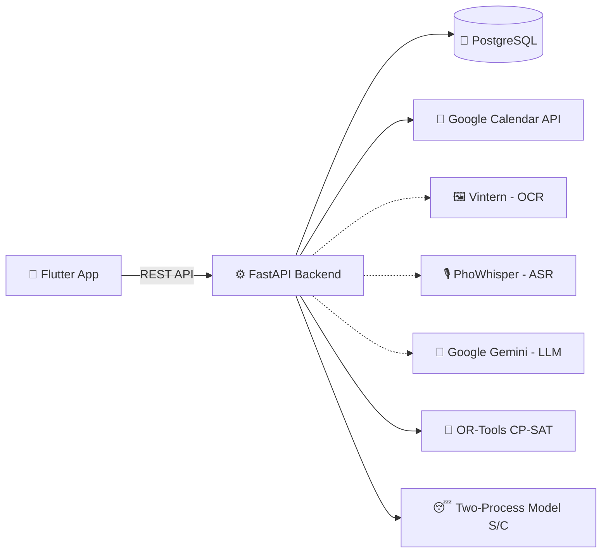

<div align="center">

# 🌿 RECOLLY

**Điều hòa lịch trình sinh hoạt cho sinh viên – cân bằng giữa học tập và nghỉ ngơi**

     

</div>

---

## 📑 Mục lục

- [Giới thiệu](#-giới-thiệu)
- [Vấn đề & mục tiêu](#-vấn-đề--mục-tiêu)
- [Tính năng chính](#-tính-năng-chính)
- [Công nghệ sử dụng](#-công-nghệ-sử-dụng)
- [Kiến trúc hệ thống](#-kiến-trúc-hệ-thống)
- [Lộ trình triển khai](#-lộ-trình-triển-khai)
- [Cài đặt & chạy thử](#-cài-đặt--chạy-thử)
- [Thành viên nhóm](#-thành-viên-nhóm)
- [Giấy phép](#-giấy-phép)

---

## 📖 Giới thiệu

**Recolly** là ứng dụng di động giúp sinh viên tự động xếp lịch học, ôn thi và thời gian nghỉ ngơi theo **nhịp sinh học cá nhân**.

Người dùng chỉ cần chụp ảnh thời khóa biểu; Recolly trích xuất dữ liệu, ước tính mức tỉnh táo trong ngày, tự xếp giờ ôn thi – giờ nghỉ vào các khung giờ phù hợp và đưa lên Google Calendar.

**Đối tượng:** sinh viên học theo hệ tín chỉ.

---

## 🎯 Vấn đề & mục tiêu

### Vấn đề

- Học theo tín chỉ nên thời khóa biểu **thay đổi mỗi kỳ**; sinh viên thường phải **nhập thủ công** vào Google Calendar vì phần mềm của trường không đồng bộ được.
- Phải tự quản lý lịch sinh hoạt, lịch ôn thi và giờ ngủ.
- Khi lịch học dày, **giấc ngủ là thứ bị hy sinh đầu tiên** mà không có công cụ nào cảnh báo.

### Mục tiêu

1. Chụp ảnh thời khóa biểu → nhận lại lịch đã được chuẩn hóa.
2. Ước tính **nợ giấc ngủ** và **mức tỉnh táo** trong ngày bằng [mô hình hai quá trình điều hòa giấc ngủ của Borbély](https://www.chronobiology.ch/wp-content/uploads/2019/05/BorbélyJSR2016.pdf).
3. Tự xếp giờ ôn thi và giờ nghỉ vào khung giờ phù hợp, rồi đẩy lên Google Calendar.

---

## ✨ Tính năng chính

### 🗓️ Module 1: Đồng bộ lịch trình
Tích hợp Google Calendar để đồng bộ thời khóa biểu và các sự kiện.

### 😴 Module 2: Chronotype & nợ ngủ
- Từ giờ ngủ ngày học và ngày nghỉ, xếp người dùng vào 1 trong 3 nhóm: 🦁 Sư tử, 🐻 Gấu, 🐺 Sói. Các nhóm này chỉ giúp dễ hiển thị, không phải chẩn đoán.
- Tính nợ ngủ 7 ngày gần nhất: `max(0, tổng của (số giờ cần ngủ − số giờ ngủ thật))`.
- Ước lượng mức tỉnh táo trong ngày bằng **Two-Process Model of Sleep Regulation** (Process S – áp lực ngủ, Process C – nhịp sinh học) của Borbély để làm cơ sở xếp lịch.

### 🔔 Module 3: Giao diện trực quan, nhắc nhở & động lực
- Nhắc giờ ngủ và các deadline sắp tới.
- Thông báo tiến độ học tập kèm các câu quote khích lệ sinh viên.

### 📸 Module 4: Nhập thời khóa biểu & lời nhắc nhanh
- Tải ảnh thời khóa biểu → hệ thống tự trích xuất và tạo lịch (OCR tiếng Việt với [Vintern-1B-v3_5](https://huggingface.co/5CD-AI/Vintern-1B-v3_5)).
- Nhập lời nhắc bằng giọng nói tiếng Việt (PhoWhisper).

---

## 🛠️ Công nghệ sử dụng

| Thành phần | Công nghệ |
|---|---|
| Mobile | Flutter |
| Backend | FastAPI (Python) |
| Cơ sở dữ liệu | PostgreSQL |
| Lịch | Google Calendar API (OAuth 2.0) |
| Xếp lịch tối ưu | OR-Tools CP-SAT |
| Nhận diện văn bản (OCR) | Vintern-1B-v3_5 |
| Nhận diện giọng nói (ASR) | PhoWhisper |
| LLM | Google Gemini |

Vintern, PhoWhisper và Gemini nằm trong kế hoạch, chưa được tích hợp vào server.

---

## 🏗️ Kiến trúc hệ thống



Nét đứt là phần chưa tích hợp. Hợp đồng API nằm ở [`docs/openapi.yaml`](docs/openapi.yaml).

---

## 🗺️ Lộ trình triển khai

Bảng dưới đây chỉ nói về backend.

### Giai đoạn 1 – Lõi hệ thống

| Tính năng | Backend |
|---|---|
| Xếp 3 con vật, đường năng lượng trong ngày | Đã có: `/chronotype/assess`, `/biorhythm` |
| Nhật ký ngủ và nợ ngủ | Đã có: `/sleep-logs`, `/sleep-debt` |
| Xếp giờ ôn thi và giờ nghỉ bằng CP-SAT, tránh thời khóa biểu và deadline | Đã có: `/schedule/generate`, `/schedule/apply` |
| Đẩy lịch lên Google Calendar | Đã có: `/calendar/sync` |
| Nhập và sửa thời khóa biểu thủ công | Đã có: `/timetable` |
| Chụp ảnh thời khóa biểu và trích xuất dữ liệu | Chưa có |

### Giai đoạn 2 – Mở rộng

| Tính năng | Backend |
|---|---|
| Thông báo nhắc giờ ngủ và deadline | Một phần: đã lưu cài đặt và thiết bị, chưa gửi thông báo |
| Đồng bộ hai chiều với Google Calendar | Đã có: `/calendar/sync`, `/calendar/conflicts`, `/calendar/webhook` |
| Nhập bằng giọng nói (PhoWhisper) | Chưa có |

### Giai đoạn 3 – Hoàn thiện

| Tính năng | Backend |
|---|---|
| Quote khích lệ | Một phần: `/quotes/random` dùng bộ câu có sẵn, chưa dùng LLM |

**Về app Flutter:** nhánh `main` đã có API client và model, nhưng `client/lib/main.dart` vẫn là màn hình mẫu của Flutter. Các màn hình đang nằm ở nhánh riêng như `UI-Rework` và `feature/r07-sign-in`.

---

## 🚀 Cài đặt & chạy thử

### Yêu cầu

- Flutter SDK có Dart `^3.13.5`
- Python `>= 3.14`
- Docker, dùng để chạy PostgreSQL 18
- Tài khoản Google Cloud (bật Calendar API, tạo OAuth 2.0 Client ID), chỉ cần cho đăng nhập và Calendar

### 1. Clone dự án

```bash
git clone https://github.com/Znoywho/Recolly.git
cd Recolly
```

### 2. Chạy database

```bash
cp .env.example .env            # điền POSTGRES_USER, POSTGRES_PASSWORD, POSTGRES_DB
docker compose up -d db         # PostgreSQL ở cổng 5433 trên máy
```

### 3. Chạy Backend

```bash
cd server
python -m venv venv
source venv/bin/activate        # Windows: venv\Scripts\activate
pip install -r requirements-dev.txt
```

Tạo file `server/.env` và không commit file này:

```bash
POSTGRES_DATABASE_URL=postgresql+psycopg2://<user>:<password>@localhost:5433/<db>
JWT_SECRET=<chuỗi ngẫu nhiên, ít nhất 32 ký tự>
TOKEN_ENCRYPTION_KEY=<kết quả của lệnh bên dưới>
GOOGLE_CLIENT_ID=<OAuth client ID>
GOOGLE_CLIENT_SECRET=<OAuth client secret>
```

```bash
python -c "from cryptography.fernet import Fernet; print(Fernet.generate_key().decode())"
uvicorn app.main:app --reload --port 8765
```

API docs: `http://localhost:8765/docs`. Cách chạy test xem ở [`server/README.md`](server/README.md).

### 4. Chạy Mobile

```bash
cd client
flutter pub get
flutter run
```

---

## 👥 Thành viên nhóm

| STT | Họ và tên | MSSV |
|:-:|---|:-:|
| 1 | Nguyễn Vũ Hoàng | 052206004253 |
| 2 | Cao Lê Huy Hoàng | 077206010722 |
| 3 | Lê Thiên Hạo | 089206010393 |

- **Giảng viên hướng dẫn:** Trương Quang Tuấn
- **Trường:** Đại học Giao thông Vận tải Thành phố Hồ Chí Minh
- **Môn:** Lập trình thiết bị di động
- **MHP:** 012012103403

---

## 📄 Giấy phép

Dự án được phát hành theo giấy phép MIT.

<div align="center">

⭐ Nếu thấy dự án hữu ích, hãy cho nhóm một **Star** nhé! ⭐

</div>
