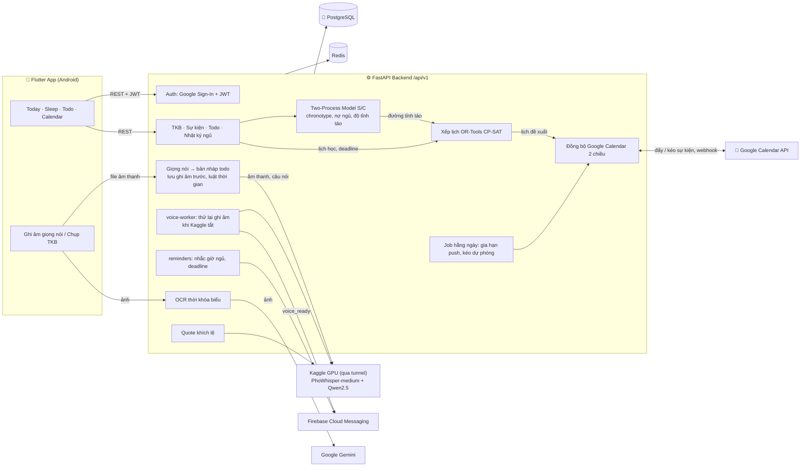

<div align="center">

# 🌿 RECOLLY

**Điều hòa lịch trình sinh hoạt cho sinh viên – cân bằng giữa học tập và nghỉ ngơi**

   -000000?logo=ollama&logoColor=white)  

</div>

---

## 📑 Mục lục

- [Chạy nhanh](#-chạy-nhanh)
- [Giới thiệu](#-giới-thiệu)
- [Vấn đề & mục tiêu](#-vấn-đề--mục-tiêu)
- [Tính năng chính](#-tính-năng-chính)
- [Công nghệ sử dụng](#-công-nghệ-sử-dụng)
- [Kiến trúc hệ thống](#-kiến-trúc-hệ-thống)
- [Lộ trình triển khai](#-lộ-trình-triển-khai)
- [Cài đặt chi tiết](#-cài-đặt-chi-tiết)
- [Cấu hình `server/.env`](#-cấu-hình-serverenv)
- [Theo dõi log & demo](#-theo-dõi-log--demo)
- [Gặp lỗi?](#-gặp-lỗi)
- [Test & đánh giá model](#-test--đánh-giá-model)
- [Thành viên nhóm](#-thành-viên-nhóm)
- [Giấy phép](#-giấy-phép)

---

## ⚡ Chạy nhanh

Cần Docker, Flutter và (cho tính năng AI) tài khoản Kaggle + một [Gemini API key](https://aistudio.google.com/apikey).

| Bước | Việc | Lệnh / nơi làm |
|:-:|---|---|
| 1 | Lấy code | `git clone https://github.com/Znoywho/Recolly.git && cd Recolly` |
| 2 | Tạo `.env` ở thư mục gốc | `cp .env.example .env` rồi điền `POSTGRES_USER`, `POSTGRES_PASSWORD`, `POSTGRES_DB` |
| 3 | Tạo `server/.env` | Chép [mẫu bên dưới](#-cấu-hình-serverenv) |
| 4 | Bật server | `docker compose up --build` → API docs: http://localhost:8765/docs |
| 5 | Bật AI trên Kaggle (giọng nói, quote) | [Bật Kaggle](#bật-kaggle-giọng-nói--quote), dán 5 dòng vào `server/.env`, `docker compose up -d` |
| 6 | Chạy app | `cd client && flutter pub get && flutter run` |

| Tính năng AI | Chạy ở đâu | Cần |
|---|---|---|
| Giọng nói → todo | Kaggle: PhoWhisper + Qwen2.5 | bước 5 |
| Quote khích lệ | Kaggle: Qwen2.5 (tắt thì dùng câu có sẵn) | bước 5 |
| Quét ảnh thời khoá biểu | Google Gemini | `GEMINI_API_KEY` |

Chưa có Kaggle hay Gemini thì server vẫn chạy, chỉ các tính năng AI tương ứng không dùng được.

---

## 📖 Giới thiệu

**Recolly** là ứng dụng di động giúp sinh viên tự động xếp lịch học, ôn thi và thời gian nghỉ ngơi theo **nhịp sinh học cá nhân**.

Người dùng chỉ cần chụp ảnh thời khóa biểu; Recolly trích xuất dữ liệu, ước tính mức tỉnh táo trong ngày, tự xếp giờ ôn thi – giờ nghỉ vào các khung giờ phù hợp và đưa lên Google Calendar.

**Đối tượng:** sinh viên học theo hệ tín chỉ.

---

## 🎯 Vấn đề & mục tiêu

### Vấn đề

- Học theo tín chỉ nên thời khóa biểu **thay đổi mỗi kỳ**; sinh viên thường phải **nhập thủ công** vào Google Calendar vì phần mềm của trường không đồng bộ được.
- Phải tự quản lý lịch sinh hoạt, lịch ôn thi và giờ ngủ.
- Khi lịch học dày, **giấc ngủ là thứ bị hy sinh đầu tiên** mà không có công cụ nào cảnh báo.

### Mục tiêu

1. Chụp ảnh thời khóa biểu → nhận lại lịch đã được chuẩn hóa.
2. Ước tính **nợ giấc ngủ** và **mức tỉnh táo** trong ngày bằng [mô hình hai quá trình điều hòa giấc ngủ của Borbély](https://www.chronobiology.ch/wp-content/uploads/2019/05/BorbélyJSR2016.pdf).
3. Tự xếp giờ ôn thi và giờ nghỉ vào khung giờ phù hợp, rồi đẩy lên Google Calendar.

---

## ✨ Tính năng chính

### 🗓️ Module 1: Đồng bộ lịch trình
Tích hợp Google Calendar để đồng bộ thời khóa biểu và các sự kiện.

### 😴 Module 2: Chronotype & nợ ngủ
- Từ giờ ngủ ngày học và ngày nghỉ, xếp người dùng vào 1 trong 3 nhóm: 🦁 Sư tử, 🐻 Gấu, 🐺 Sói. Các nhóm này chỉ giúp dễ hiển thị, không phải chẩn đoán.
- Tính nợ ngủ 7 ngày gần nhất: `max(0, tổng của (số giờ cần ngủ − số giờ ngủ thật))`.
- Ước lượng mức tỉnh táo trong ngày bằng **Two-Process Model of Sleep Regulation** (Process S – áp lực ngủ, Process C – nhịp sinh học) của Borbély để làm cơ sở xếp lịch. Hằng số lấy đúng bộ của Daan, Beersma & Borbély (1984) theo [Skeldon & Dijk (2025)](https://doi.org/10.1038/s44323-025-00039-z), Hình 1: χs = 4.2 h, χw = 18.2 h, H0+ = 0.67, H0− = 0.17, a = 0.12.
- Nguồn của từng công thức, hằng số và phần nào còn là giả định của nhóm (ví dụ `KSS = 7.5 − 9·A`): [`docs/sleep-model.md`](docs/sleep-model.md).

### 🔔 Module 3: Giao diện trực quan, nhắc nhở & động lực
- Nhắc giờ ngủ và các deadline sắp tới.
- Thông báo tiến độ học tập kèm các câu quote khích lệ sinh viên.

### 📸 Module 4: Nhập thời khóa biểu & lời nhắc nhanh
- Tải ảnh thời khóa biểu → hệ thống trích xuất môn học để người dùng xem lại rồi lưu (Google Gemini).
- Nhập lời nhắc bằng giọng nói tiếng Việt (PhoWhisper).

---

## 🛠️ Công nghệ sử dụng

| Thành phần | Công nghệ |
|---|---|
| Mobile | Flutter |
| Backend | FastAPI (Python) |
| Cơ sở dữ liệu | PostgreSQL |
| Lịch | Google Calendar API (OAuth 2.0) |
| Xếp lịch tối ưu | OR-Tools CP-SAT |
| Đọc ảnh thời khoá biểu (OCR) | Google Gemini (`gemini-3.5-flash-lite`) qua REST API |
| Nhận diện giọng nói (ASR) | [PhoWhisper-medium](https://huggingface.co/vinai/PhoWhisper-medium) trên GPU Kaggle |
| LLM | Qwen2.5 chạy qua [Ollama](https://ollama.com) trên GPU Kaggle (giọng nói → todo, quote) |
| Thông báo đẩy | Firebase Cloud Messaging (HTTP v1) |
| Hạ tầng | Docker Compose, Redis (rate limit, chống gửi trùng), Cloudflare quick tunnel (webhook Google), ngrok (app kết nối server khi demo), [Dozzle](https://dozzle.dev) (xem log) |

PhoWhisper và Qwen2.5 chạy trên GPU của Kaggle (notebook `server/notebooks/kaggle_ollama.ipynb`), server gọi qua tunnel
Cloudflare; ảnh thời khoá biểu gửi tới Gemini. Máy chạy server không cần GPU hay `torch`.

---

## 🏗️ Kiến trúc hệ thống



Hợp đồng API nằm ở [`docs/openapi.yaml`](docs/openapi.yaml).

Chi tiết từng pipeline:
- 🎙️ Giọng nói → todo: [`docs/voice-pipeline.md`](docs/voice-pipeline.md)
- 📷 Ảnh thời khoá biểu → môn học (OCR): [`docs/ocr-pipeline.md`](docs/ocr-pipeline.md)
- 😴 Mô hình giấc ngủ — công thức, hằng số, nguồn và mức độ kiểm chứng: [`docs/sleep-model.md`](docs/sleep-model.md)
- 📅 Đồng bộ Google Calendar: [`docs/google-calendar-sync.md`](docs/google-calendar-sync.md)

---

## 🗺️ Lộ trình triển khai

Bảng dưới đây chỉ nói về backend.

### Giai đoạn 1 – Lõi hệ thống

| Tính năng | Backend |
|---|---|
| Xếp 3 con vật, đường năng lượng trong ngày | Đã có: `/chronotype/assess`, `/biorhythm` |
| Nhật ký ngủ và nợ ngủ | Đã có: `/sleep-logs`, `/sleep-debt` |
| Xếp giờ ôn thi và giờ nghỉ bằng CP-SAT, tránh thời khóa biểu, khung giờ bận (cả giờ bận trên Google Calendar) và giữ khoảng đệm trước deadline; bài cần tập trung cao vào giờ vàng, việc nhẹ vào giờ thấp ([`server/docs/scheduler.md`](server/docs/scheduler.md)) | Đã có: `/schedule/generate`, `/schedule/apply` |
| Sự kiện và todo/deadline; báo trùng giờ và tự dời khối học CP-SAT bị đè; chỉ todo có giờ cố định mới thành sự kiện | Đã có: `/events`, `/todos` |
| Đẩy lịch lên Google Calendar (tự động sau mỗi thay đổi, vào lịch "Recolly" riêng; người dùng chọn chế độ `off` / `push` / `two_way`) | Đã có: `/calendar/settings`, `/calendar/sync` |
| Nhập và sửa thời khóa biểu thủ công | Đã có: `/timetable` |
| Chụp ảnh thời khóa biểu và trích xuất dữ liệu | Đã có: `/ocr/timetable` (xem giai đoạn 2) |

### Giai đoạn 2 – Mở rộng

| Tính năng | Backend |
|---|---|
| Thông báo nhắc giờ ngủ, deadline (trước 24 h và 2 h) và 15 phút trước khối học / todo có giờ | Đã có: service `reminders` (mỗi 5 phút) gửi push FCM, chống gửi trùng qua Redis |
| Đồng bộ hai chiều với Google Calendar | Đã có: `/calendar/sync`, `/calendar/conflicts`, `/calendar/webhook`; sửa khác field thì tự gộp, cùng field thì theo `conflict_policy`; service `calendar-maintenance` gia hạn kênh push và kéo dữ liệu dự phòng mỗi ngày. Thiết kế: [`server/docs/calendar_sync.md`](server/docs/calendar_sync.md), kịch bản test: [`server/docs/sync_test_cases.md`](server/docs/sync_test_cases.md) |
| Nhập bằng giọng nói → bản nháp todo | Đã có: `/voice/transcribe` (PhoWhisper + Qwen2.5 trên Kaggle; khi Ollama tắt thì chỉ dùng luật). **Ghi âm được lưu trước**: Kaggle tắt thì trả `202`, service `voice-worker` thử lại mỗi phút và gửi push `voice_ready`; xem trạng thái ở `/voice/jobs/{id}`. Chi tiết ở [`server/README.md`](server/README.md) |
| OCR ảnh thời khoá biểu | Đã có: `POST /ocr/timetable` trả `202` ngay, Gemini đọc ảnh thành môn học; app hỏi `/ocr/jobs/{id}` mỗi ~2 s rồi lưu bằng `POST /timetable`. Không gọi được model thì job `failed` với `OCR_MODEL_ERROR`. Chi tiết ở [`docs/ocr-pipeline.md`](docs/ocr-pipeline.md) |
| Giới hạn tần suất gọi API | Đã có: 120 request/phút mỗi người, riêng `/schedule/generate` 10/phút và tối đa 2 lần giải cùng lúc. Webhook Google `/calendar/webhook` cũng bị giới hạn 120/phút theo IP (IP của Google, dùng chung): ổn cho demo, cần xem lại khi nhiều người dùng |

### Giai đoạn 3 – Hoàn thiện

| Tính năng | Backend |
|---|---|
| Quote khích lệ | Đã có: `/quotes/random` (Qwen2.5 qua Ollama theo nợ ngủ và deadline; lỗi thì dùng câu có sẵn) |

**Về app Flutter:** app đã có các màn hình Today, Biorhythm, Sleep, Todo (danh sách + form), Calendar (tuần, lịch đề xuất, chi tiết sự kiện), kết nối Google Calendar, nhập/quét thời khóa biểu, Personal và màn hình chào (`client/lib/features/`).

---

## 🚀 Cài đặt chi tiết

### Yêu cầu

- Flutter SDK có Dart `^3.13.5`
- Python `>= 3.14`
- Docker, dùng để chạy PostgreSQL 18
- Tài khoản Google Cloud (bật Calendar API, tạo OAuth 2.0 Client ID), chỉ cần cho đăng nhập và Calendar

### 1. Clone dự án

```bash
git clone https://github.com/Znoywho/Recolly.git
cd Recolly
```

### 2. Chạy bằng Docker (nhanh nhất)

```bash
cp .env.example .env            # điền POSTGRES_USER, POSTGRES_PASSWORD, POSTGRES_DB
# tạo server/.env theo mục "Cấu hình server/.env"
docker compose up --build       # PostgreSQL ở cổng 5433, Redis ở 127.0.0.1:6380, API ở cổng 8765
```

| Service | Việc |
|---|---|
| `db`, `redis` | PostgreSQL 18, Redis 7 |
| `server` | API FastAPI, cổng 8765 |
| `reminders` | Nhắc giờ ngủ / deadline / 15 phút trước khối học, chạy mỗi 5 phút (`python -m app.jobs.send_reminders --loop`) |
| `calendar-maintenance` | Mỗi ngày: gia hạn kênh webhook Google Calendar, kéo dự phòng khi không còn kênh (`python -m app.jobs.calendar_maintenance --loop`) |
| `voice-worker` | Thử lại các ghi âm lưu lúc Kaggle tắt (mỗi phút), xoá ghi âm sau 7 ngày (`python -m app.jobs.process_voice --loop`) |
| `logs` | Dozzle, xem log mọi container: http://localhost:8888 (chỉ máy này) |
| `tunnel` | Cloudflare tunnel cho webhook Google Calendar; chỉ chạy khi `docker compose --profile tunnel up` |

Ghi âm nằm trong volume `voice-audio` (không mất khi `docker compose down`; `down -v` thì mất cả DB).

Service `reminders` không có key FCM thì chỉ ghi log.
Không có key FCM thì nó chỉ ghi log. Muốn push thật tới điện thoại, tạo `docker-compose.override.yml`
(đã gitignore, chỉ nằm trên máy bạn; không commit key):

```yaml
services:
  reminders:
    environment:
      FCM_SERVICE_ACCOUNT_FILE: /run/secrets/fcm.json
    volumes:
      - ~/secrets/recolly-fcm.json:/run/secrets/fcm.json:ro
```

Muốn chạy backend trực tiếp trên máy để dev thì làm bước 3 và 4.

### 3. Chỉ chạy database

```bash
cp .env.example .env            # điền POSTGRES_USER, POSTGRES_PASSWORD, POSTGRES_DB
docker compose up -d db         # PostgreSQL ở cổng 5433 trên máy
```

### 4. Chạy Backend

```bash
cd server
python -m venv venv
source venv/bin/activate        # Windows: venv\Scripts\activate
pip install -r requirements-dev.txt
```

Tạo `server/.env` theo mục [Cấu hình](#-cấu-hình-serverenv) bên dưới.

```bash
python -c "from cryptography.fernet import Fernet; print(Fernet.generate_key().decode())"
uvicorn app.main:app --reload --port 8765
```

API docs: `http://localhost:8765/docs`.

### 5. Chạy Mobile

```bash
cd client
flutter pub get
flutter run
```

---

## 🔧 Cấu hình `server/.env`

Không commit file này.

```bash
# Bắt buộc
POSTGRES_DATABASE_URL=postgresql+psycopg2://<user>:<password>@localhost:5433/<db>   # Docker tự ghi đè
JWT_SECRET=<chuỗi ngẫu nhiên, ít nhất 32 ký tự>
TOKEN_ENCRYPTION_KEY=<lệnh tạo ở bên dưới>
GOOGLE_CLIENT_ID=<OAuth client ID>
GOOGLE_CLIENT_SECRET=<OAuth client secret>

# Quét ảnh thời khoá biểu (OCR_PROVIDER mặc định là gemini)
GEMINI_API_KEY=<key từ https://aistudio.google.com/apikey>
# GEMINI_MODEL=gemini-3.5-flash-lite

# Giọng nói + quote: 5 dòng do notebook Kaggle in ra mỗi lần chạy
OLLAMA_BASE_URL=https://<...>.trycloudflare.com
OLLAMA_MODEL=qwen2.5:14b
ASR_BASE_URL=https://<...>.trycloudflare.com
ASR_TOKEN=<token của session Kaggle>
PHOWHISPER_MODEL=vinai/PhoWhisper-medium
VOICE_LLM_MODEL=qwen2.5:14b     # máy yếu: qwen2.5:7b và VOICE_REPAIR_TRANSCRIPT=0

# Tùy chọn
WEBHOOK_BASE_URL=<URL HTTPS công khai cho push của Google Calendar>
```

Tạo `TOKEN_ENCRYPTION_KEY`:

```bash
python -c "from cryptography.fernet import Fernet; print(Fernet.generate_key().decode())"
```

> ⚠️ **Riêng tư với Gemini:** ở bản miễn phí, Google có thể dùng và cho người đọc dữ liệu gửi lên, và [điều khoản](https://aistudio.google.com/docs/terms) yêu cầu không gửi thông tin cá nhân. Demo bằng ảnh thử hoặc ảnh đã che tên, mã sinh viên; có người dùng thật thì phải bật thanh toán.

---

## 🔎 Theo dõi log & demo

### Kết nối app với server qua ngrok

Server chạy trên máy cá nhân nên app (emulator hoặc điện thoại) vào qua một domain ngrok cố định. Mặc định mọi thứ đều tắt.

1. `docker compose up -d`, chờ khoảng 30 giây, rồi kiểm tra `curl localhost:8765/api/v1/health` trả `status: ok, db: ok, redis: ok`.
2. Mở tunnel (port **8765**): `ngrok http 8765 --url=https://<domain-của-bạn>.ngrok-free.dev`. Giữ terminal này mở suốt buổi demo.
3. Kiểm tra tunnel: `curl -H "ngrok-skip-browser-warning: true" https://<domain-của-bạn>.ngrok-free.dev/api/v1/health`.
4. Chạy app (`-d` nhận device ID, xem bằng `flutter devices`):

```bash
cd client && flutter run -d emulator-5554 \
  --dart-define=USE_MOCK_API=false \
  --dart-define=API_BASE_URL=https://<domain-của-bạn>.ngrok-free.dev/api/v1 \
  --dart-define=GOOGLE_SERVER_CLIENT_ID=<web-client-id>.apps.googleusercontent.com
```

`GOOGLE_SERVER_CLIENT_ID` phải trùng Web client ID mà server dùng. Thiếu nó thì app báo "Đăng nhập Google lỗi" và server không thấy request `POST /auth/google`.

| Triệu chứng | Cách xử lý |
|---|---|
| ngrok `502` / lỗi `8012` | Docker hoặc server chưa lên: bật compose, chờ ~30 giây |
| `curl: (56) Connection reset` ngay sau compose up | Server đang khởi động, thử lại sau |
| ngrok lỗi `6024` (trang cảnh báo gói free) | Thêm header `ngrok-skip-browser-warning: true` |

Chỉ tunnel port 8765, **không** tunnel Dozzle (8888). Đừng bật "Protect it" của ngrok vì nó chặn app hoặc xung đột với header `Authorization: Bearer`; API đã có JWT và giới hạn tần suất. Authtoken ngrok và client secret không ghi vào README hay commit.

### Bật Kaggle (giọng nói + quote)

1. Mở `server/notebooks/kaggle_ollama.ipynb` trên Kaggle, chọn **GPU T4 x2**, bật **Internet**, rồi *Run All*.
2. Cell tunnel in ra 5 dòng (`OLLAMA_BASE_URL`, `OLLAMA_MODEL`, `ASR_BASE_URL`, `ASR_TOKEN`, `PHOWHISPER_MODEL`): dán vào `server/.env`, rồi `docker compose up -d` (tạo lại container để đọc `.env` mới).
3. Kiểm tra: `curl $ASR_BASE_URL/health` trả `{"status": "ok", ...}`.

URL và token đổi mỗi session. Không dán chúng lên chat/issue/PR và không commit notebook còn output. Demo xong thì tắt session Kaggle.

### Xem log bằng Dozzle

Mở http://localhost:8888 và chọn container:

| Container | Thấy gì |
|---|---|
| `recolly-server-container` | Mỗi request một dòng (`POST /api/v1/schedule/generate 200 812ms user:<id>`), đăng nhập, xếp lịch, đồng bộ Google, `Ollama … ok` / `ASR via … ok` |
| `recolly-voice-worker-container` | `Voice run: {...}` mỗi phút |
| `recolly-reminders-container` | `Push sent …`, `Reminders run: {...}` |
| `recolly-tunnel-container` | URL webhook (khi bật `--profile tunnel`) |

Vàng = WARNING (lỗi 4xx, Kaggle không tới được), đỏ = ERROR (lỗi 5xx). Server không ghi nội dung câu nói, chỉ ghi độ dài.
Chạy server bằng `uvicorn` (không Docker) thì log hiện ở terminal.

---

## 🆘 Gặp lỗi?

| Triệu chứng | Cách xử lý |
|---|---|
| Quét ảnh: `503 OCR_UNAVAILABLE` | Chưa có `GEMINI_API_KEY`. Sửa `.env`, `docker compose up -d` |
| Quét ảnh: job `OCR_MODEL_ERROR` | Xem log server: sai key hoặc hết hạn mức (`429`, bản miễn phí 15 lượt/phút) |
| Server không khởi động: `OCR_PROVIDER=... is not supported` | Giá trị chỉ nhận `gemini` hoặc `vintern` |
| Đổi `.env` mà không thấy tác dụng | `docker compose up -d` (không dùng `restart`) |
| Kaggle: `Speech server crashed` | Chạy `!tail -n 30 /kaggle/working/asr_server.log` ở cell mới để xem nguyên nhân |
| Kaggle: `nvidia-smi: not found` | Chưa chọn GPU T4 x2 trong *Session options* |
| Giọng nói trả `202`, chưa có kết quả | Kaggle đang tắt; ghi âm đã được lưu và `voice-worker` thử lại mỗi phút |

---

## 🧪 Test & đánh giá model

Test (trong `server/`, cách bật database test xem [`server/README.md`](server/README.md)):

```bash
pytest
```

| Muốn đo | Lệnh (trong `server/`) |
|---|---|
| Sinh bộ ảnh thời khoá biểu giả | `python -m scripts.generate_timetables --zip` |
| Gemini đọc ảnh | `python -m scripts.gemini_ocr_eval` |
| So hai report OCR | `python -m scripts.ocr_eval <report> outputs/ocr_dataset/dev [report_2]` |
| So quote Ollama với Gemini | `python -m scripts.quote_eval`, chấm CSV, rồi thêm `--score` |
| Xem kết quả ASR, parser, quote dạng web | `python scripts/notebook_report.py` → `notebooks/report.html` |

`server/outputs/` chứa kết quả sinh ra, không commit. Notebook đo Vintern cũ: `notebooks/kaggle_ocr_eval.ipynb`.

---

## 👥 Thành viên nhóm

| STT | Họ và tên | MSSV |
|:-:|---|:-:|
| 1 | Nguyễn Vũ Hoàng | 052206004253 |
| 2 | Cao Lê Huy Hoàng | 077206010722 |
| 3 | Lê Thiên Hạo | 089206010393 |

- **Giảng viên hướng dẫn:** Trương Quang Tuấn
- **Trường:** Đại học Giao thông Vận tải Thành phố Hồ Chí Minh
- **Môn:** Lập trình thiết bị di động
- **MHP:** 012012103403

---

## 📄 Giấy phép

Dự án được phát hành theo giấy phép MIT.

<div align="center">

⭐ Nếu thấy dự án hữu ích, hãy cho nhóm một **Star** nhé! ⭐

</div>
