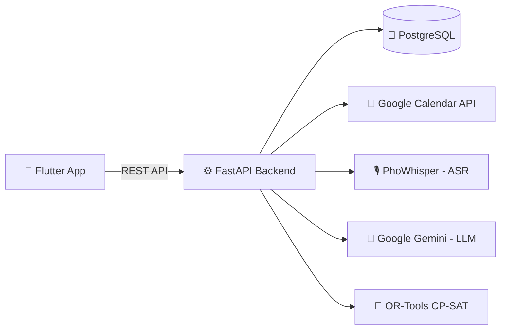

<div align="center">

# 🌿 RECOLLY

**Ứng dụng hỗ trợ sinh viên cân bằng giữa Học tập – Sức khỏe – Tài chính cá nhân**

     

</div>

---

## 📑 Mục lục

- [Giới thiệu](#-gi%E1%BB%9Bi-thi%E1%BB%87u)
- [Phân tích khoảng trống (Gap Analysis)](#-ph%C3%A2n-t%C3%ADch-kho%E1%BA%A3ng-tr%E1%BB%91ng-gap-analysis)
- [Tính năng chính](#-t%C3%ADnh-n%C4%83ng-ch%C3%ADnh)
- [Công nghệ sử dụng](#-c%C3%B4ng-ngh%E1%BB%87-s%E1%BB%AD-d%E1%BB%A5ng)
- [Kiến trúc hệ thống](#-ki%E1%BA%BFn-tr%C3%BAc-h%E1%BB%87-th%E1%BB%91ng)
- [Cài đặt & chạy thử](#-c%C3%A0i-%C4%91%E1%BA%B7t--ch%E1%BA%A1y-th%E1%BB%AD)
- [Hướng phát triển tương lai](#-h%C6%B0%E1%BB%9Bng-ph%C3%A1t-tri%E1%BB%83n-t%C6%B0%C6%A1ng-lai)
- [Thành viên nhóm](#-th%C3%A0nh-vi%C3%AAn-nh%C3%B3m)
- [Giấy phép](#-gi%E1%BA%A5y-ph%C3%A9p)

---

## 📖 Giới thiệu

**Recolly** là ứng dụng di động được phát triển nhằm giải quyết bài toán **cân bằng giữa việc học tập, theo dõi sức khỏe và quản lý tài chính cá nhân** trên cùng một nền tảng duy nhất.

**Đối tượng người dùng:** Sinh viên đại học và người đi làm có nhu cầu cân bằng sức khỏe, ngân sách sinh hoạt và các thói quen hằng ngày.

**Phạm vi liên kết:**

- 📅 Tích hợp đa chiều các lịch trình (Google Calendar API)
- 🎙️ Speech-to-Text (nhận diện giọng nói tiếng Việt)
- 🩺 Hồ sơ sức khỏe (nhịp sinh học, bệnh nền, dị ứng)
- 🍜 Dinh dưỡng AI (Computer Vision) – _định hướng phát triển_

### Ba mảng chính

|Mảng|Mô tả|
|---|---|
|🗓️ **Quản lý lịch trình thông minh**|Tự động quét thời khóa biểu, sắp xếp lịch học cận ngày thi, quản lý deadline và tích hợp Pomodoro|
|💰 **Quản lý chi tiêu thông minh**|Ghi nhận khoản chi qua giọng nói, tự động phân loại danh mục, cảnh báo hạn mức ngân sách, dự trù chi phí theo từng sự kiện|
|❤️ **Chăm sóc sức khỏe & dinh dưỡng AI**|Theo dõi nhịp sinh học, lưu trữ hồ sơ sức khỏe, theo dõi giấc ngủ, nhận diện thực đơn hằng ngày bằng Computer Vision|

---

## 🔍 Phân tích khoảng trống (Gap Analysis)

|Nhóm ứng dụng tham khảo|Hạn chế hiện tại|Recolly giải quyết|
|---|---|---|
|**Lịch & Quản lý công việc**<br>(Google Calendar, Notion, TickTick)|Chỉ quản lý thời gian đơn thuần; không tự nhận diện thời khóa biểu tín chỉ từ ảnh chụp; tách biệt hoàn toàn với tài chính; không tự xếp lịch nghỉ theo nhịp sinh học khi lịch học quá tải|Tự động trích xuất TKB từ ảnh, liên kết lịch với ngân sách và nhịp sinh học|
|**Quản lý chi tiêu**<br>(Money Lover, Spendee, Wallet)|Phụ thuộc nhập liệu thủ công; chưa tối ưu hiểu câu nói tự nhiên để tách khoản chi; thiếu liên kết với lịch sự kiện và thói quen sinh hoạt|Ghi chi tiêu bằng giọng nói, tự parse thành dữ liệu có cấu trúc, gắn với sự kiện lịch|
|**Hạn chế hệ thống & bảo mật**|Hệ sinh thái phân mảnh buộc người dùng cài nhiều app rời rạc; rủi ro rò rỉ dữ liệu y tế nhạy cảm lên đám mây quốc tế, chưa tuân thủ quy định nội địa (Nghị định 13/2023/NĐ-CP)|Một ứng dụng tích hợp, hướng tới tuân thủ quy định bảo vệ dữ liệu cá nhân của Việt Nam|

---

## ✨ Tính năng chính

### 🗓️ Module 1: Lịch trình

- **Nhập thời khóa biểu & lời nhắc nhanh:** tải ảnh thời khóa biểu, hệ thống tự động trích xuất và tạo lịch.
- **Đồng bộ hai chiều:** tích hợp Google Calendar để đồng bộ thời khóa biểu và các sự kiện.
- **Bộ đếm tập trung (Pomodoro):** kích hoạt chế độ tập trung trực tiếp trên các sự kiện học tập.

### 💰 Module 2: Quản lý chi tiêu thông minh bằng giọng nói

- **Ghi nhận bằng giọng nói (Speech-to-Text via AI API):** người dùng bấm ghi âm một câu tự nhiên, ví dụ _"Hôm nay ăn trưa 40k, đổ xăng 50k"_. Hệ thống gửi audio/text lên API để parse thành JSON và tự lưu vào lịch sử:
    
    ```json
    [
      { "khoan_chi": "ăn trưa", "so_tien": 40000, "danh_muc": "Ăn uống" },
      { "khoan_chi": "đổ xăng", "so_tien": 50000, "danh_muc": "Di chuyển" }
    ]
    ```
    
- **Phân bổ ngân sách & mức chi gợi ý:** nhập ngân sách tổng hàng tháng; hệ thống tự tính mức chi an toàn trung bình cho các ngày còn lại trong tháng.
    
- **Dự trù chi phí sự kiện:** đính kèm số tiền dự kiến khi tạo lịch hẹn (đi chơi, mua sách, sinh nhật) để kiểm soát rủi ro vượt ngân sách.
    

### ❤️ Module 3: AI Health Care

- **Hồ sơ sức khỏe tĩnh:** form lưu thông tin dị ứng (đậu phộng, hải sản,...), bệnh nền, thuốc đang dùng để làm bộ lọc an toàn.
- **Theo dõi nhịp sinh học:** ước lượng mức độ tập trung và tỉnh táo của người dùng trong suốt cả ngày dựa trên **mô hình hai quá trình điều hòa giấc ngủ (Two-Process Model of Sleep Regulation – Borbély)**.

---

## 🛠️ Công nghệ sử dụng

|Thành phần|Công nghệ|
|---|---|
|Mobile|Flutter|
|Backend|FastAPI (Python)|
|Cơ sở dữ liệu|PostgreSQL|
|Lịch|Google Calendar API (OAuth 2.0)|
|Xếp lịch tối ưu|OR-Tools CP-SAT|
|AI / NLP|PhoWhisper (ASR), Google Gemini (LLM)|

---

## 🏗️ Kiến trúc hệ thống



> 💡 _Bạn có thể thay sơ đồ trên bằng ảnh kiến trúc chi tiết hơn của nhóm._

---

## 🚀 Cài đặt & chạy thử

### Yêu cầu

- Flutter SDK `>= 3.x`
- Python `>= 3.10`
- PostgreSQL `>= 14`
- Tài khoản Google Cloud (bật Calendar API, tạo OAuth 2.0 Client ID)
- API key Google Gemini

### 1. Clone dự án

```bash
git clone https://github.com/<username>/recolly.git
cd recolly
```

### 2. Chạy Backend

```bash
cd backend
python -m venv venv
source venv/bin/activate        # Windows: venv\Scripts\activate
pip install -r requirements.txt

cp .env.example .env            # điền DATABASE_URL, GEMINI_API_KEY, GOOGLE_CLIENT_ID...
uvicorn app.main:app --reload
```

API docs: `http://localhost:8000/docs`

### 3. Chạy Mobile

```bash
cd mobile
flutter pub get
flutter run
```

---

## 🔭 Hướng phát triển tương lai

### 🍽️ Dinh dưỡng & Thị giác máy tính nâng cao (Computer Vision)

- **Nhận diện đĩa ăn 3D qua camera:** YOLOv11 + SAM 2 + Depth Anything V2 để nhận diện món ăn Việt Nam phức tạp, đo thể tích 3D và tính chính xác lượng calo cùng 86 chất dinh dưỡng.
- **Gợi ý thực đơn bằng Quy hoạch tuyến tính (ILP):** tối ưu thực đơn theo tuần/tháng, đáp ứng nhu cầu Calo/TDEE, đúng ngân sách còn lại và loại bỏ món trùng lặp gây chán.

### 📍 Định vị không gian & gợi ý quán ăn GPS (PostGIS)

- Tích hợp PostGIS trên PostgreSQL, dùng truy vấn không gian (`ST_DWithin`) để quét quán ăn trong bán kính **1.5 km** quanh vị trí GPS thực tế, phù hợp hạn mức chi tiêu còn lại trong ngày.

### 🧠 Tự động hóa lịch trình & chế độ ôn thi thông minh

- Khai thác OR-Tools CP-SAT để quét khoảng trống lịch học, tự xếp lịch ôn thi trước ngày thi và tự chèn khoảng nghỉ (_strategic nap_) khi nhịp sinh học rơi vào "điểm trũng năng lượng".

---

## 👥 Thành viên nhóm

|STT|Họ và tên|MSSV|
|:-:|---|:-:|---|
|1|Nguyễn Vũ Hoàng|052206004253|
|2|Cao Lê Huy Hoàng|077206010722|
|3|Lê Thiên Hạo|089206010393|

- **Giảng viên hướng dẫn:** Trương Quang Tuấn
- **Trường**:  Đại học Giao thông Vận tải Thành phố Hồ Chí Minh 
- **Môn**: Lập trình thiết bị di động
- **MHP**: 012012103403

---

## 📄 Giấy phép

Dự án được phát hành theo giấy phép MIT.

<div align="center">

⭐ Nếu thấy dự án hữu ích, hãy cho nhóm một **Star** nhé! ⭐

</div>
