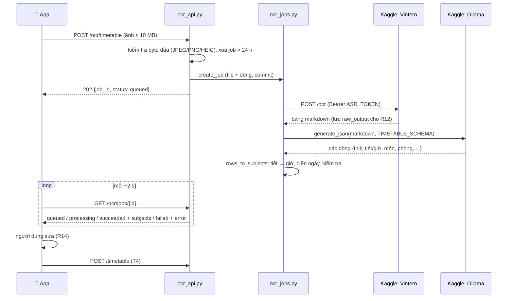

# Pipeline ảnh thời khoá biểu → môn học (OCR) — kiến trúc

> Owner: Backend — Member 1 (R09–R12). Phía Flutter: Member 2 (R13, R14, R16), Member 3 (màn quét / quét lỗi, R62).
> Ghi ngày 2026-11-25. Hợp đồng API: `T1 POST /ocr/timetable`, `T2 GET /ocr/jobs/{id}`, `T4 POST /timetable` trong [`openapi.yaml`](openapi.yaml).

## 1. Tóm tắt

1. **T1 trả `202` ngay.** Ảnh và một dòng `ocr_jobs` được lưu, rồi OCR chạy trong background task của FastAPI. App hỏi T2 mỗi ~2 s.
2. **Vintern-1B-v3_5 đọc ảnh** trên GPU Kaggle, trả về bảng **markdown**. Nó chạy chung process, GPU, tunnel và token với PhoWhisper (`POST /ocr`), nên server dùng luôn `ASR_BASE_URL` / `ASR_TOKEN`.
3. **Ollama (`qwen2.5:14b`, cùng model với voice) chuyển markdown thành từng dòng** theo JSON schema, và chỉ chép những gì có trong bảng.
4. **Code đổi tiết ra giờ và điền ngày thiếu**, nên cùng một bảng luôn ra cùng kết quả. Dòng nào hỏng thì bỏ.
5. **Server không tự lưu môn học.** App cho người dùng sửa rồi gọi T4.
6. **Không có hàng đợi thử lại** (khác voice). Người dùng đang đứng chờ ở màn quét, nên Kaggle tắt → job `failed` `OCR_MODEL_ERROR` → app hiện màn quét lỗi.

## 2. Luồng

## 3. Mã lỗi

| Khi nào | HTTP / `error` |
|---|---|
| File không phải JPEG/PNG/HEIC (kiểm tra byte đầu, không tin tên file) | `400 UNSUPPORTED_IMAGE` |
| Ảnh > 10 MB | `413 FILE_TOO_LARGE` |
| > 10 lần upload/phút | `429 RATE_LIMITED` |
| `ASR_BASE_URL` chưa đặt | `503 OCR_UNAVAILABLE` |
| Kaggle không mở được ảnh | job `failed`, `OCR_LOW_QUALITY` |
| Kaggle hoặc Ollama tắt, hoặc lỗi bất ngờ | job `failed`, `OCR_MODEL_ERROR` |
| Đọc xong nhưng không có dòng nào dùng được | job `failed`, `OCR_NO_TABLE_FOUND` |
| Job > 24 h | `404 OCR_JOB_NOT_FOUND` |

## 4. Quy tắc dòng → môn học (`timetable_parser.py`)

- Bảng ghi giờ (`7:30`, `07:30`, `7h30`) → dùng giờ đó. Bảng ghi tiết → tra `PERIOD_TIMES` (giờ bắt đầu của tiết đầu, giờ kết thúc của tiết cuối).
- Thiếu ngày bắt đầu → hôm nay; thiếu ngày kết thúc → bắt đầu + 15 tuần. Khi đó `confidence = 0.6` (bình thường 0.9) để app tô vàng cho người dùng kiểm tra.
- Bị bỏ: tiết không có trong bảng, không có giờ lẫn tiết, thứ ngoài 1–7, tên rỗng, giờ kết thúc ≤ giờ bắt đầu.

## 5. Giả định cần thay

| | Hiện tại | Cần làm |
|---|---|---|
| `PERIOD_TIMES` | Bảng tạm (tiết 1 = 07:00, 50 phút) | Điền giờ tiết thật của trường |
| `confidence` | 0.9 / 0.6 cố định | Vintern không trả độ tin cậy; đo lại khi có ảnh thật (R12) |
| Prompt Vintern + Ollama | Viết tay, chưa thử trên ảnh thật | Thử và sửa với ảnh mẫu |
| `OCR_DTYPE = float16` | T4 không có bf16 gốc | Nếu kết quả rỗng/lộn xộn thì thử `bfloat16` |

## 6. Kiểm tra (R12, chưa làm)

Cần 10–20 ảnh thời khoá biểu thật kèm nhãn tay (môn, thứ, giờ, phòng). Script so khớp từng trường với `raw_output` + `result` của job, giống `kaggle_voice_eval`.
