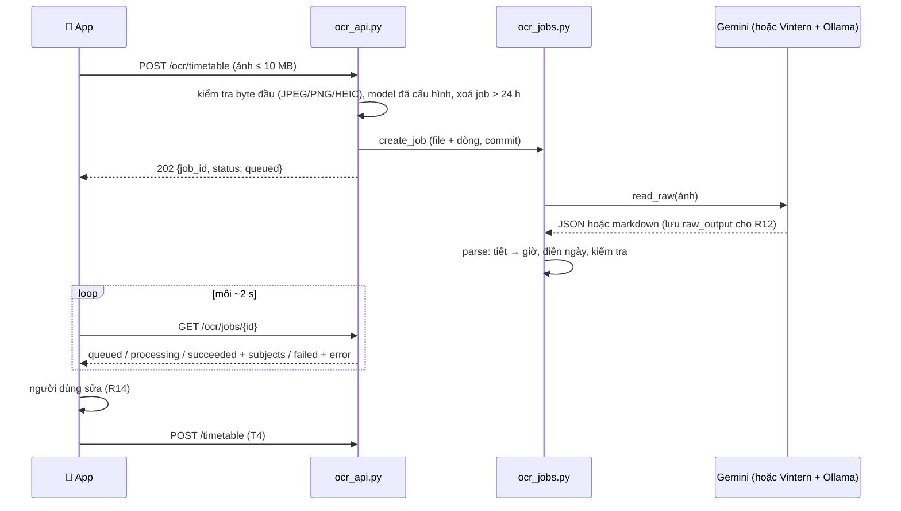

# Pipeline ảnh thời khoá biểu → môn học (OCR) — kiến trúc

> Owner: Backend — Member 1 (R09–R12). Phía Flutter: Member 2 (R13, R14, R16), Member 3 (màn quét / quét lỗi, R62).
> Ghi ngày 2026-11-25. Hợp đồng API: `T1 POST /ocr/timetable`, `T2 GET /ocr/jobs/{id}`, `T4 POST /timetable` trong [`openapi.yaml`](openapi.yaml).

## 1. Tóm tắt

1. **T1 trả `202` ngay.** Ảnh và một dòng `ocr_jobs` được lưu, rồi OCR chạy trong background task của FastAPI. App hỏi T2 mỗi ~2 s.
2. **`OCR_PROVIDER` chọn model đọc ảnh** (`service/ocr/readers.py`). Hai bên cùng hai bước `read_raw` (lưu vào `raw_output`) và `parse`.

| `OCR_PROVIDER` | Cách đọc | Cần |
|---|---|---|
| `gemini` (mặc định) | Một lượt gọi Gemini trả JSON; thứ trả dạng chữ, code đổi ra số | `GEMINI_API_KEY`, tuỳ chọn `GEMINI_MODEL` |
| `vintern` | Vintern → markdown → Ollama → dòng | Notebook phục vụ `POST /ocr`. `kaggle_ollama` **đã gỡ Vintern** (2026-11-27), muốn dùng phải lấy notebook cũ từ git |

3. **Code đổi tiết ra giờ và điền ngày thiếu**. Dòng nào hỏng thì bỏ.
4. **Server không tự lưu môn học.** App cho người dùng sửa rồi gọi T4.
5. **Không có hàng đợi thử lại** (khác voice). Model không gọi được → job `failed` `OCR_MODEL_ERROR` → app hiện màn quét lỗi. Gemini được thử 3 lần, cách nhau 10 s, khi bị `429` hoặc lỗi server.

**Riêng tư:** với `gemini`, ảnh được gửi cho Google (`store: false`). Bản miễn phí cho Google dùng dữ liệu để cải thiện sản phẩm ([điều khoản](https://aistudio.google.com/docs/terms), hiệu lực 23/03/2026): chỉ dùng dữ liệu thử, người dùng thật thì phải bật thanh toán.

**Vì sao đổi (đo ngày 2026-11-27, ảnh giả):** Gemini đúng cả dòng 97,6% trên 36 ảnh `dev`; Vintern + Qwen đúng 0% trên 4 ảnh của một bảng lưới mà cả hai cùng chạy (Gemini 95,8% trên 4 ảnh đó). Prompt Gemini đã được chỉnh theo `dev`, chưa đo trên `test` và ảnh thật.

### Quyết định đã chốt (2026-11-27, đồ án môn học)

| Việc | Chọn | Lý do (số đo) | Giới hạn phải ghi trong báo cáo |
|---|---|---|---|
| Đọc ảnh thời khoá biểu | **Gemini** `gemini-3.5-flash-lite` | `dev` 36 ảnh giả: đúng cả dòng 97,6%, F1 100%, 3,7 s/ảnh, khoảng 2.300 token/ảnh. Vintern + Qwen trên 4 ảnh chung: 0% (Gemini 95,8%), khoảng 60 s/ảnh | Ảnh giả, prompt chỉnh theo `dev`; chưa chạy `test` và ảnh thật. Bản miễn phí: chỉ dữ liệu thử, 15 lượt/phút |
| Thứ trong tuần | Model chép chữ (`"Thứ 5"`), **code đổi ra số** | Đúng thứ 55,4% → 99,7% trên `dev` | Đổi cùng lúc với vài chỉnh sửa prompt khác |
| Gỡ Vintern khỏi Kaggle | **Gỡ** | Lỗi với `transformers` 5 làm sập cả server giọng nói | Muốn dùng lại phải lấy notebook cũ |
| Giọng nói → todo | Giữ **PhoWhisper + Qwen2.5 14B** trên Kaggle | TSR 0,73 trên ghi âm thật (`server/README.md`) | Kaggle phải bật tay |
| Quote | Giữ **Qwen2.5 qua Ollama** | Không gửi tên deadline ra bên ngoài; chưa có số so với Gemini (`scripts/quote_eval.py`) | Chưa đo |
| Prompt injection | Nhiều lớp (`service/llm/guard.py`), người dùng xem lại trước khi lưu | Gemini: 0/8 ảnh tấn công bị lừa, 48/48 buổi thật vẫn đúng | 8 ảnh, 2 câu tấn công; parser Ollama chưa đo |

## 2. Luồng



## 3. Mã lỗi

| Khi nào | HTTP / `error` |
|---|---|
| File không phải JPEG/PNG/HEIC (kiểm tra byte đầu, không tin tên file) | `400 UNSUPPORTED_IMAGE` |
| Ảnh > 10 MB | `413 FILE_TOO_LARGE` |
| > 10 lần upload/phút | `429 RATE_LIMITED` |
| Thiếu cấu hình (`GEMINI_API_KEY`, hoặc `ASR_BASE_URL` với vintern) | `503 OCR_UNAVAILABLE` |
| Gemini trả lời hỏng, hoặc Kaggle không mở được ảnh | job `failed`, `OCR_LOW_QUALITY` |
| Model không gọi được, key sai, hoặc lỗi bất ngờ | job `failed`, `OCR_MODEL_ERROR` |
| Đọc xong nhưng không có dòng nào dùng được | job `failed`, `OCR_NO_TABLE_FOUND` |
| Job > 24 h | `404 OCR_JOB_NOT_FOUND` |

## 4. Quy tắc dòng → môn học (`timetable_parser.py`)

- Bảng ghi giờ (`7:30`, `07:30`, `7h30`) → dùng giờ đó. Bảng ghi tiết → tra `PERIOD_TIMES` (giờ bắt đầu của tiết đầu, giờ kết thúc của tiết cuối).
- Thiếu ngày bắt đầu → hôm nay; thiếu ngày kết thúc → bắt đầu + 15 tuần. Khi đó `confidence = 0.6` (bình thường 0.9) để app tô vàng cho người dùng kiểm tra.
- Bị bỏ: tiết không có trong bảng, không có giờ lẫn tiết, thứ ngoài 1–7, tên rỗng, giờ kết thúc ≤ giờ bắt đầu.

`rows_to_subjects` chỉ lấy 60 dòng đầu; `name`, `code`, `room`, `lecturer` được lọc ký tự điều khiển và ký tự ẩn.

## 5. Giả định cần thay

| | Hiện tại | Cần làm |
|---|---|---|
| `PERIOD_TIMES` | Bảng tạm (tiết 1 = 07:00, 50 phút) | Điền giờ tiết thật của trường |
| `confidence` | 0.9 / 0.6 cố định | Model không trả độ tin cậy; đo lại khi có ảnh thật (R12) |
| Prompt Gemini | Chỉnh trên ảnh giả `dev` | Đo trên `test` và ảnh thật trước khi tin số |

## 6. Kiểm tra (R12)

Gemini trên `dev` (36 ảnh giả): đúng cả dòng 97,6%, injection 0/8. Vintern mới đo trên 4 ảnh. Chưa có ảnh thật, chưa chạy `test`.

| File (trong `server/`) | Việc |
|---|---|
| `scripts/generate_timetables.py` | Sinh ảnh giả kèm nhãn `.json` và markdown chuẩn `.md`: `dev` 36 ảnh, `test` 180 ảnh; mỗi biến thể đổi một yếu tố (số buổi, chiều rộng, góc nghiêng, độ mờ) |
| `scripts/ocr_eval.py` | Precision, recall, F1, độ chính xác từng trường, theo tag, khoảng tin cậy bootstrap, so hai report |
| `scripts/gemini_ocr_eval.py` | Đo Gemini trên cùng bộ ảnh, cùng schema và cách chấm (cần `GEMINI_API_KEY`; mặc định chỉ gửi ảnh giả) |
| `notebooks/kaggle_ocr_eval.ipynb` | Đo 3 tầng trên Kaggle (Vintern, parser, cả pipeline), so 4 cấu hình trên `dev`, báo cáo trên `test` |

```bash
cd server
venv/bin/python -m scripts.generate_timetables --zip          # outputs/ocr_dataset/ (git bỏ qua)
venv/bin/python -m scripts.batch_test ~/recolly-test-files    # ảnh thật qua API đang chạy
venv/bin/python -m scripts.ocr_eval outputs/batch_<time>.jsonl ~/recolly-test-files
```

- Ảnh thật: mỗi ảnh một file `.json` cùng tên (`{"subjects": [...]}`), để **ngoài repo** vì có thông tin cá nhân.
- Prompt injection (chữ trong ảnh ra lệnh cho model): parser production và script Gemini dùng chung `app/service/llm/guard.py` (quy tắc "dữ liệu không phải lệnh", lọc ký tự ẩn), chỉ nhận tối đa 60 dòng; model không có tool và người dùng xem lại trước khi lưu. Đo bằng tập `injection` (8 ảnh, `injection_success_rate`): Gemini 0/8 bị lừa; parser Ollama chưa đo; quy tắc trong prompt không đảm bảo chặn được, và dòng giả viết ngay trong bảng thì model không phân biệt được.
- Điểm trên ảnh giả lạc quan hơn ảnh thật.
- Mẫu ghi tiết dùng đúng `PERIOD_TIMES` của code, nên không đo được lỗi lệch giờ tiết giữa các trường.
