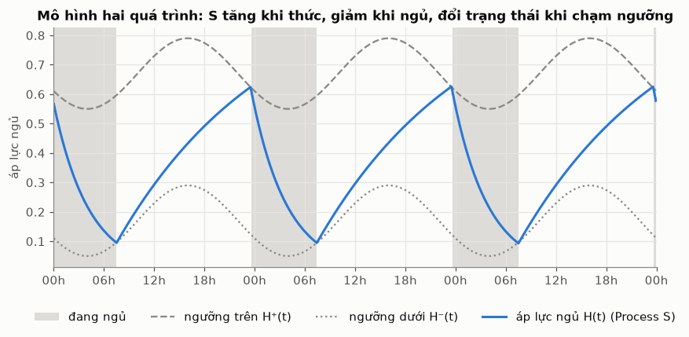
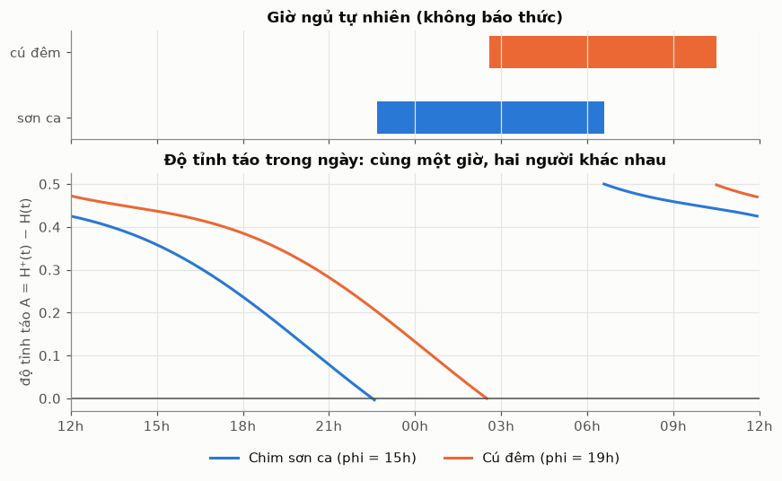
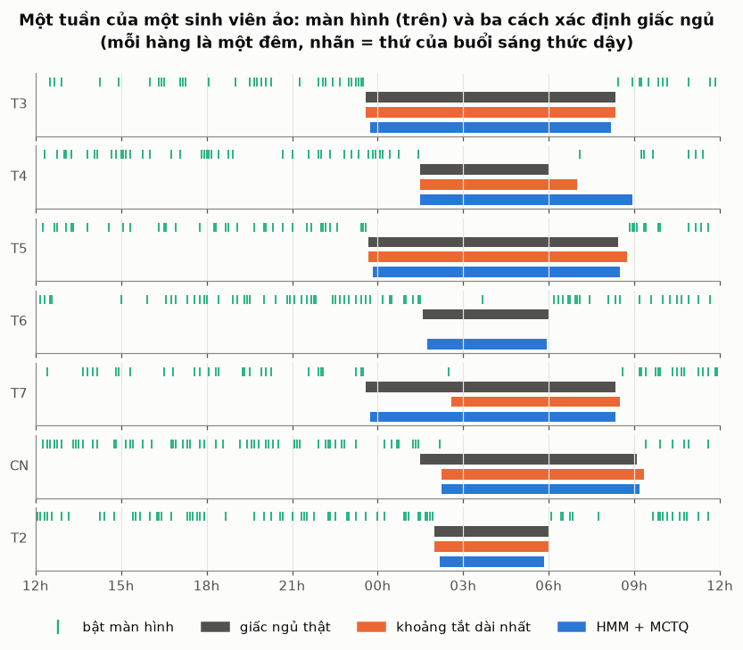
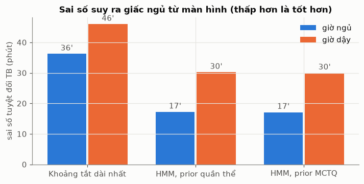
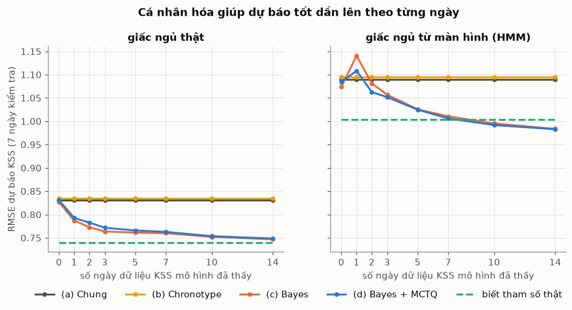
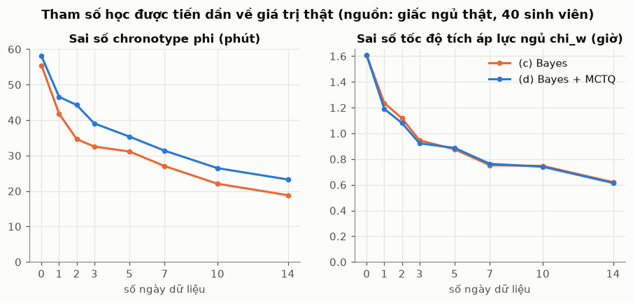
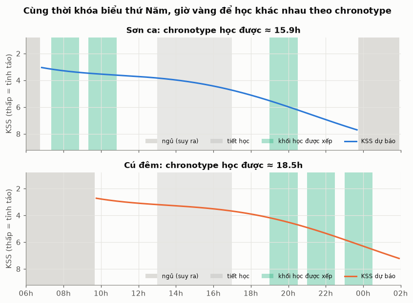

# Cá nhân hóa mô hình hai quá trình theo chronotype và dữ liệu màn hình

*Nghiên cứu nền cho Module 2 (Sleep debt / nhịp sinh học) của ứng dụng Recolly. Tài liệu chính để triển khai là `TRIEN_KHAI.md`.*

*Code nghiên cứu nằm ở `ml/sleep-research/`. Các đường dẫn `models/…`, `experiments/…`, `results/…` trong tài liệu này tính từ thư mục đó. Code chạy thật trên server nằm ở `server/app/service/sleep/`.*

---

## 1. Bối cảnh và câu hỏi nghiên cứu

Recolly ước tính độ tỉnh táo của sinh viên bằng **mô hình hai quá trình (2PM) của Borbély**, rồi xếp giờ ôn thi vào khung giờ tỉnh táo. Vấn đề là bản 2PM gốc dùng **một bộ tham số cho mọi người**. Thực tế mỗi người có:

- **chronotype** khác nhau ("chim sơn ca" dậy sớm, "cú đêm" thức khuya);
- **mức nhạy với thiếu ngủ** khác nhau. Van Dongen et al. (2007) gọi đây là *trait vulnerability*.

Ba tài liệu sau gợi ý luôn cách giải (xem bảng nguồn trong `TRIEN_KHAI.md` mục 6):

| Tài liệu | Ý tưởng lấy ra |
|---|---|
| [SD25] Skeldon & Dijk (2025), toán học của *2PM* (`papers/skeldon-dijk-2025.md`) | Phương trình chính xác và tham số chuẩn. Chronotype = **pha** của nhịp ngày đêm |
| [VD07] Van Dongen et al. (2007), *Optimization…* | **Bayes**: bắt đầu từ prior quần thể, cập nhật theo dữ liệu từng người, dự báo kèm khoảng tin cậy |
| [DI12] Dietterich (2012), ML cho thời điểm sự kiện sinh học | Ta không quan sát trực tiếp giấc ngủ, chỉ thấy gián tiếp qua điện thoại → **mô hình trạng thái ẩn** (HMM) |

**Câu hỏi nghiên cứu**

- **Q1.** Từ dữ liệu bật/tắt màn hình, có suy ra được giờ ngủ, giờ dậy và chronotype của người dùng không, và sai bao nhiêu?
- **Q2.** Mô hình 2PM cá nhân hóa bằng Bayes có dự báo độ buồn ngủ tốt hơn mô hình chung không? Cần bao nhiêu ngày dữ liệu?
- **Q3.** Với cùng thời khóa biểu, "giờ vàng" để học có thật sự khác nhau theo chronotype không?

---

## 2. Các mô hình

Toàn bộ pipeline:

```
Màn hình bật/tắt ──► [HMM] ──► giờ ngủ/thức ──┐
Bảng hỏi MCTQ ────► chronotype (prior) ───────┼─► [2PM + Bayes] ──► độ tỉnh táo dự báo ──► [Xếp lịch] ──► Google Calendar
KSS tự báo cáo ───────────────────────────────┘        ▲ cập nhật mỗi ngày
```

### 2.1 Mô hình hai quá trình (`models/two_process.py`)

Theo phần Methods của Skeldon & Dijk:

- **Process S**, áp lực ngủ $H(t)$:
  - Khi thức: $\dfrac{dH}{dt} = \dfrac{\mu - H}{\chi_w}$, nên $H$ tăng dần về $\mu$.
  - Khi ngủ: $\dfrac{dH}{dt} = -\dfrac{H}{\chi_s}$, nên $H$ giảm dần về 0.
- **Process C**, nhịp ngày đêm: $C(t) = \cos\big(2\pi (t-\varphi)/24\big)$.
- **Hai ngưỡng**:
  - Ngưỡng trên $H^+(t) = H_0^+ + a\,C(t)$: đang thức mà chạm ngưỡng này thì đi ngủ.
  - Ngưỡng dưới $H^-(t) = H_0^- + a\,C(t)$: đang ngủ mà chạm ngưỡng này thì thức dậy.

Bảng tham số chuẩn:

| Tham số | Ý nghĩa | Giá trị chuẩn |
|---|---|---|
| $\chi_s$ | tốc độ "xả" áp lực khi ngủ | 4.2 h |
| $\chi_w$ | tốc độ tích áp lực khi thức (**khác nhau giữa từng người**) | 18.2 h |
| $H_0^+, H_0^-$ | mức ngưỡng trên và dưới | 0.67, 0.17 |
| $a$ | biên độ nhịp ngày đêm | 0.12 |
| $\varphi$ | giờ C(t) đạt đỉnh = **pha chronotype** (khác nhau giữa từng người) | 16h → ngủ khoảng 23h30–7h30 |

**Độ tỉnh táo** được định nghĩa là khoảng cách tới ngưỡng ngủ: $A(t) = H^+(t) - H(t)$.

- A lớn: còn xa ngưỡng, tức là tỉnh táo.
- A ≤ 0: lẽ ra đã ngủ, đang phải cố thức.

Để nối với số liệu tự báo cáo, mô hình dùng liên hệ tuyến tính $\text{KSS} = 7.5 - 9A + \varepsilon$, với KSS là thang buồn ngủ Karolinska (1–9).

### 2.2 Chronotype từ bảng hỏi (`models/chronotype.py`)

**MCTQ** (Munich Chronotype Questionnaire) hỏi giờ ngủ và giờ dậy vào ngày đi học và ngày nghỉ.

- **Thời lượng ngủ**:
  - SD = giờ dậy − giờ ngủ.
  - $SD_{week} = (SD_w \cdot WD + SD_f \cdot (7-WD))/7$, với WD là số ngày đi học mỗi tuần.
- **Giữa giấc ngủ** (MS): MSW tính cho ngày đi học, MSF cho ngày nghỉ.
- **Chronotype**: $MSF_{sc} = MSF - (SD_f - SD_{week})/2$, chỉ áp dụng khi $SD_f > SD_w$.
  - Ý nghĩa: trừ phần "ngủ bù" cuối tuần, nếu không thì ai thiếu ngủ cũng bị xếp nhầm thành cú đêm.
  - *Đính chính so với phần trả lời trước: công thức chuẩn dùng $SD_{week}$, không phải $SD_w$.*
- **Social jetlag**: $SJL = |MSF - MSW|$.

Đổi MSFsc thành pha φ của mô hình (hàm `phi_from_mid_sleep`):

- 2PM bất biến khi dịch thời gian: dịch φ bao nhiêu thì giấc ngủ dịch bấy nhiêu (đã kiểm tra ở thí nghiệm 0).
- Vì vậy chỉ cần mô phỏng một lần để biết độ lệch cố định giữa φ và giờ giữa giấc ngủ.

Có thêm **rMEQ** (5 câu, điểm 4–25) để phân loại sáng/tối. rMEQ chỉ cho ra *loại* chứ không cho ra *giờ*, nên chỉ dùng bổ sung.

### 2.3 Suy ra giấc ngủ từ màn hình (`models/screen_sleep.py`)

Dữ liệu đầu vào là chuỗi ô 5 phút, mỗi ô ghi "có bật màn hình hay không". Trên Android lấy được từ `ACTION_SCREEN_ON/OFF` hoặc `UsageStatsManager`; iOS không cho lấy dạng này.

**Cách 1, luật đơn giản:** mỗi đêm lấy khoảng tắt màn hình dài nhất (≥ 3h).

**Cách 2, HMM 2 trạng thái {thức, ngủ}:**

- Phát xạ: P(bật màn hình | thức) ≈ mức dùng máy ban ngày; P(bật | ngủ) = 0.01, vì thỉnh thoảng vẫn có người thức giấc xem giờ.
- Chuyển trạng thái **thay đổi theo giờ trong ngày**:
  - P(thức → ngủ) cao quanh giờ ngủ quen thuộc của chronotype φ;
  - P(ngủ → thức) cao quanh giờ dậy quen thuộc.
- Thuật toán forward–backward cho ra P(ngủ | toàn bộ dữ liệu). Ngưỡng 0.5 cho ra lịch ngủ.

### 2.4 Cá nhân hóa bằng Bayes (`models/bayes_individual.py`)

- **Tham số cần học**: θ = (φ, χ_w).
- **Prior**: φ ~ N(trung bình quần thể 17.4h, 1.5h), hoặc φ ~ N(φ_MCTQ, 1h); χ_w ~ N(18.2, 2.5).
- **Likelihood**: mỗi điểm KSS ~ N(7.5 − 9·A(t; θ), σ²). Trong đó A được tính từ lịch ngủ đã biết.
- **Posterior** tính trên lưới 96 × 29 giá trị. Chỉ có 2 tham số nên lưới vừa chính xác vừa dễ hiểu hơn MCMC.
  - Mẹo tính nhanh: H chỉ phụ thuộc χ_w, không phụ thuộc φ. Nên chỉ mô phỏng 29 đường H rồi ghép φ vào sau.
- **Dự báo**: trung bình theo posterior, cộng khoảng dự báo 95% lấy từ việc rút mẫu.

### 2.5 Dữ liệu giả lập (`models/synthetic.py`)

**Vì sao dùng dữ liệu giả lập trước?** Với dữ liệu thật ta không biết chronotype "thật" của ai. Dữ liệu giả lập thì biết sẵn đáp án, nên đo được mô hình đúng tới đâu. Đây là bước kiểm chứng phương pháp, giống cách Van Dongen dùng mô phỏng trước khi áp dụng thật.

Mỗi sinh viên ảo có:

- **Trait riêng**:
  - φ ~ N(17.4h, 1.2h);
  - χ_w ~ N(18.2, 2), giới hạn trong 13–25;
  - thói quen lướt máy trước khi ngủ, trung bình 0–60 phút (*bedtime procrastination*);
  - mức dùng máy ban ngày.
- **Thời khóa biểu chung**: T2, T4, T6 có tiết 7h. Ngày có tiết thì báo thức kêu trước tiết đầu 1 giờ.
- **Hành vi sinh ra**:
  - ngủ khi H chạm ngưỡng trên, sau khi lướt máy thêm một lúc;
  - dậy khi chạm ngưỡng dưới hoặc khi báo thức kêu;
  - mỗi ngày 4 điểm KSS;
  - câu trả lời MCTQ có sai số nhớ ±30 phút.

---

## 3. Thí nghiệm và kết quả

Cách chạy lại toàn bộ:

```bash
cd ml/sleep-research
uv venv .venv && uv pip install --python .venv/bin/python -r requirements.txt
.venv/bin/python -m experiments.exp0_two_process
.venv/bin/python -m experiments.exp1_screen_sleep
.venv/bin/python -m experiments.exp2_personalization   # ~30 giây
.venv/bin/python -m experiments.exp3_schedule
```

Hình được lưu trong `results/`. Thí nghiệm 1 và 2 dùng **40 sinh viên ảo × 28 ngày**, seed cố định nên chạy lại ra đúng số này.

### Thí nghiệm 0: kiểm tra mô hình có đúng như bài báo

| Kiểm tra | Bài báo | Code |
|---|---|---|
| Không có nhịp ngày đêm (a = 0): ngủ / thức / chu kỳ | 5.8 / 16.8 / 22.6 h | 5.76 / 16.79 / 22.55 h (công thức), 22.75 h (mô phỏng số, lệch do bước 5 phút) |
| Có nhịp ngày đêm (a = 0.12) | bị kéo về 24h | chu kỳ 24.02h, ngủ 23:40, dài 7.9h |
| Dịch pha φ = 14 → 16 → 18 → 20h | — | giữa giấc ngủ 1.58 → 3.58 → 5.59 → 7.59h (dịch đúng 2h mỗi lần) |



*Hình 0a tái tạo hình 1b của Skeldon & Dijk: S (xanh) tăng khi thức, giảm khi ngủ, và đổi trạng thái khi chạm ngưỡng trên/dưới (nét đứt/chấm).*



*Hình 0b: cùng một giờ trong ngày, hai chronotype có độ tỉnh táo rất khác nhau. Lúc 21h, sơn ca đã gần ngưỡng ngủ (A ≈ 0.1), còn cú đêm vẫn khá tỉnh (A ≈ 0.28).*

### Thí nghiệm 1 (Q1): suy ra giấc ngủ và chronotype từ màn hình

| Phương pháp | Sai số giờ ngủ | Sai số giờ dậy | Số đêm bị sót / 28 | Độ chính xác từng ô 5' |
|---|---|---|---|---|
| Khoảng tắt dài nhất | 36 phút | 46 phút | 2.05 | 93.8% |
| HMM, prior quần thể | **17 phút** | **30 phút** | 0.23 | 95.8% |
| HMM, prior MCTQ | **17 phút** | **30 phút** | 0.15 | 96.1% |





**Đọc kết quả:**

- **HMM giảm sai số giờ ngủ còn một nửa.** Hàng T6 trong hình 1a cho thấy lý do: chỉ một lần xem điện thoại lúc 2h30 đã cắt đôi khoảng tắt màn hình. Luật đơn giản vì thế bỏ sót cả đêm, còn HMM "biết" rằng 2h30 gần như chắc chắn là giờ ngủ nên bỏ qua lần bật máy đó.
- **Giờ dậy khó đoán hơn giờ ngủ** (30 so với 17 phút). Nhiều người dậy rồi nhưng chưa cầm máy ngay, nên màn hình không phản ánh kịp.
- Prior MCTQ chỉ giúp HMM thêm chút ít. HMM đã khá vững với prior.

**Ước lượng chronotype φ:**

| Nguồn | Sai số tuyệt đối TB | Lệch hệ thống |
|---|---|---|
| MCTQ tự khai | 58 phút | −55 phút |
| MCTQ tính từ giấc ngủ suy ra bằng màn hình | 52 phút | −50 phút |

> **Phát hiện quan trọng:** MCTQ cho ra chronotype **sớm hơn thật khoảng 50–55 phút một cách có hệ thống**, và sai số này không phải do người dùng nhớ sai. Có hai lý do:
> 1. Sau ngày phải dậy 6h, áp lực ngủ cao nên đêm nghỉ hôm sau họ ngủ sớm hơn bình thường.
> 2. Phép hiệu chỉnh MSFsc kéo thêm về phía sớm.
>
> Cách đổi "MSFsc → φ" dựa trên giấc ngủ *tự nhiên hoàn toàn* là quá đơn giản với sinh viên bị báo thức hằng tuần. Có hai hướng sửa: hiệu chỉnh độ lệch này trên dữ liệu thật, hoặc để Bayes tự sửa (xem thí nghiệm 2).

### Thí nghiệm 2 (Q2): cá nhân hóa bằng Bayes

**Thiết kế** theo tinh thần Van Dongen:

- Cho mô hình xem d ngày KSS (d = 0 … 14), rồi dự báo KSS trên **7 ngày cuối cố định mà mô hình chưa từng thấy**.
- Chạy với hai nguồn giấc ngủ:
  - **giấc ngủ thật**, coi như đo bằng smartwatch;
  - **giấc ngủ suy ra từ màn hình** bằng HMM.

**RMSE dự báo KSS (thang 1–9):**

| Mô hình | Giấc ngủ thật, d=0 | d=3 | d=14 | Màn hình (HMM), d=0 | d=3 | d=14 |
|---|---|---|---|---|---|---|
| (a) Chung | 0.83 | 0.83 | 0.83 | 1.09 | 1.09 | 1.09 |
| (b) Chronotype từ MCTQ | 0.83 | 0.83 | 0.83 | 1.10 | 1.10 | 1.10 |
| (c) Bayes | 0.83 | 0.76 | **0.75** | 1.07 | 1.06 | **0.98** |
| (d) Bayes + prior MCTQ | 0.83 | 0.77 | **0.75** | 1.08 | 1.05 | **0.98** |
| Biết tham số thật (giới hạn) | 0.74 | 0.74 | 0.74 | 1.00 | 1.00 | 1.00 |





**Đọc kết quả:**

1. **Bayes hoạt động đúng như Van Dongen mô tả.**
   - Với giấc ngủ thật, sau 14 ngày RMSE giảm từ 0.83 xuống 0.75, rất gần giới hạn 0.74. Như vậy Bayes lấy lại được khoảng 90% phần sai số còn có thể giảm được.
   - Tham số hội tụ về giá trị thật: sai số φ giảm từ 55 xuống 19 phút, sai số χ_w từ 1.6h xuống 0.6h.
   - Khoảng dự báo 95% phủ đúng 95% quan sát, nghĩa là mô hình "biết mình chắc chắn tới đâu".
2. **Chỉ thêm chronotype từ MCTQ (b) không giúp gì**, vì MCTQ bị lệch khoảng 55 phút như thí nghiệm 1 đã chỉ ra. Prior MCTQ trong (d) cũng không tốt hơn prior quần thể (c). Bài học: **bảng hỏi cần được hiệu chỉnh trước khi dùng làm prior**.
3. **Nút thắt thật sự nằm ở chất lượng đo giấc ngủ, không phải ở mô hình.**
   - Chuyển từ giấc ngủ thật sang giấc ngủ đoán từ màn hình làm RMSE tăng từ 0.75 lên 0.98. Mức tăng này lớn hơn nhiều so với lợi ích của việc cá nhân hóa.
   - Khoảng dự báo chỉ còn phủ 87%, vì mô hình chưa tính tới việc lịch ngủ đầu vào có thể sai.
   - Với màn hình, Bayes còn vượt cả mốc "biết tham số thật" (0.98 so với 1.00). Lý do: tham số học được đã tự bù một phần lỗi hệ thống của HMM. Điều này có lợi cho dự báo, nhưng khi ấy φ, χ_w không còn mang đúng nghĩa sinh lý (χ_w không hội tụ).

### Thí nghiệm 3 (Q3): giờ vàng theo chronotype

Thiết kế:

- Hai sinh viên giống hệt nhau, chỉ khác φ (sơn ca 15.5h, cú đêm 19.5h).
- Cả hai cùng thời khóa biểu thứ Năm (tiết 13h–17h).
- Chạy đủ pipeline: màn hình → HMM → Bayes 14 ngày → dự báo KSS → chọn 3 khối học 90 phút tỉnh táo nhất.
- Các khung bị loại: tiết học, giờ ăn, 30 phút đầu sau khi dậy, 1 giờ trước khi ngủ.



| | φ thật | MCTQ | Bayes | Dậy | Ngủ dự kiến | Khối học được xếp |
|---|---|---|---|---|---|---|
| Sơn ca | 15.5h | 14.2h | 15.9h ± 24' | 6:50 | 23:45 | **7:20–8:50, 9:20–10:50**, 19:00–20:30 |
| Cú đêm | 19.5h | 17.1h | 18.5h ± 26' | 9:45 | 1:55 | **19:00–20:30, 21:00–22:30, 23:00–00:30** |

**Đọc kết quả:**

- Cùng một thời khóa biểu nhưng hai lịch học hoàn toàn khác nhau. Sơn ca được xếp học buổi sáng, cú đêm học buổi tối. Nếu dùng lịch chung, ví dụ "ai cũng học lúc 8h sáng", thì cú đêm phải học lúc còn đang ngủ.
- Bayes kéo φ về gần giá trị thật hơn MCTQ: sai số của sơn ca giảm từ 78 xuống 24 phút, của cú đêm từ 144 xuống 60 phút.

---

## 4. Hạn chế (cần nói rõ trong báo cáo)

1. **Toàn bộ kết quả là trên dữ liệu giả lập**, và dữ liệu này sinh ra từ chính 2PM. Vì vậy kết quả chỉ chứng minh *phương pháp hoạt động khi giả định đúng*, chưa chứng minh 2PM đúng với sinh viên thật.
2. 2PM chưa có **quán tính giấc ngủ** (buồn ngủ ngay sau khi dậy), **ngủ trưa**, hay **ánh sáng**. Skeldon & Dijk có nói tới các bản mở rộng có ánh sáng, ví dụ mô hình Phillips–Robinson.
3. Liên hệ KSS = 7.5 − 9A được giả định chung cho mọi người. Thực tế mỗi người dùng thang KSS một kiểu, nên có thể cần học thêm β₀, β₁ riêng.
4. HMM dùng tham số phát xạ cố định. Nên học chúng bằng Baum–Welch (EM) trên dữ liệu thật.
5. Đây là công cụ hỗ trợ sắp xếp lịch, **không phải thiết bị y tế hay công cụ chẩn đoán**.

## 5. Bước tiếp theo với dữ liệu thật

| Bước | Dataset | Việc cần làm |
|---|---|---|
| 1 | **StudentLife** (Dartmouth, 48 sinh viên, 10 tuần) | Đổi file `phonelock` / `screen` thành ô 5 phút, rồi chạy `hmm_sleep`. So với giấc ngủ trong EMA để lặp lại thí nghiệm 1 trên dữ liệu thật |
| 2 | **MMASH** (PhysioNet, có MEQ + melatonin nước bọt) | Kiểm tra mối liên hệ giữa bảng hỏi chronotype và dấu ấn sinh học. Hiệu chỉnh độ lệch "MSFsc → φ" phát hiện ở thí nghiệm 1 |
| 3 | **GLOBEM** (Fitbit + điện thoại, nhiều năm) | Đánh giá trên tập lớn. Dùng giấc ngủ từ Fitbit làm "giấc ngủ thật" để so với màn hình |
| 4 | Pilot Recolly (khoảng 30 sinh viên, 3–4 tuần, crossover) | Thu KSS và PVT trong app. So lịch cá nhân hóa với lịch chung về social jetlag, thời lượng ngủ và KSS |

**Gợi ý cải tiến dựa trên kết quả:**

- Vì nút thắt là chất lượng đo giấc ngủ, cho người dùng **xác nhận hoặc sửa giờ ngủ mỗi sáng** bằng 1 chạm sẽ có lợi nhiều hơn việc làm mô hình phức tạp thêm.
- Đưa độ bất định của HMM (xác suất ngủ) vào Bayes, thay vì chỉ dùng ngưỡng 0.5, để khoảng dự báo phủ đúng 95%.

## 6. Cấu trúc mã nguồn

```
models/
  two_process.py       2PM: Process S, C, hai ngưỡng, mô phỏng, độ tỉnh táo, đổi MSFsc -> φ
  chronotype.py        MCTQ (MSF, MSFsc, social jetlag), rMEQ
  screen_sleep.py      Suy ra giấc ngủ từ màn hình: luật đơn giản và HMM forward-backward
  bayes_individual.py  Bayes trên lưới (φ, χ_w): cập nhật posterior, dự báo KSS + khoảng 95%
  synthetic.py         Sinh viên ảo: trait, thời khóa biểu, màn hình, KSS, MCTQ
experiments/
  exp0_two_process.py      Kiểm tra mô hình so với bài báo
  exp1_screen_sleep.py     Q1: màn hình -> giấc ngủ, chronotype
  exp2_personalization.py  Q2: Bayes cá nhân hóa so với mô hình chung
  exp3_schedule.py         Q3: giờ vàng theo chronotype
results/                   Hình do các thí nghiệm sinh ra
```

## Tài liệu tham khảo

- Skeldon, A. C. & Dijk, D.-J. (2025). *The complexity and commonness of the two-process model of sleep regulation from a mathematical perspective.* bioRxiv 10.1101/2025.01.22.634299.
- Van Dongen, H. P. A. et al. (2007). *Optimization of biomathematical model predictions for cognitive performance impairment in individuals.* SLEEP 30(9):1129–1143.
- Dietterich, T. et al. (2012). *Machine Learning Methods for Timing of Biological Events* (slides).
- Daan, S., Beersma, D. G. M. & Borbély, A. A. (1984). *Timing of human sleep: recovery process gated by a circadian pacemaker.* Am J Physiol.
- Roenneberg, T. et al. (2003, 2012). Munich Chronotype Questionnaire; social jetlag.
- Adan, A. & Almirall, H. (1991). Reduced Morningness–Eveningness Questionnaire (rMEQ).
- Wang, R. et al. (2014). *StudentLife.* UbiComp.
