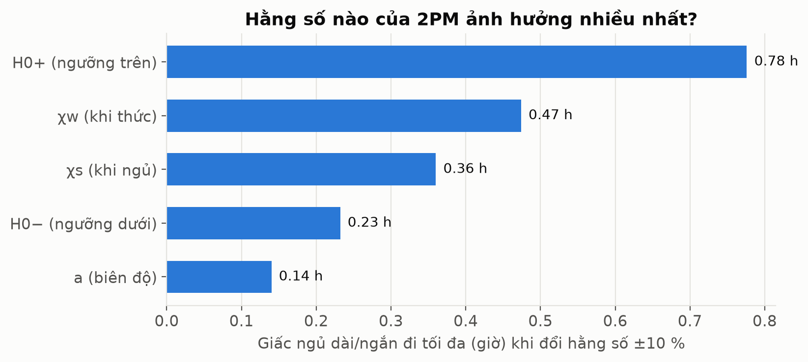
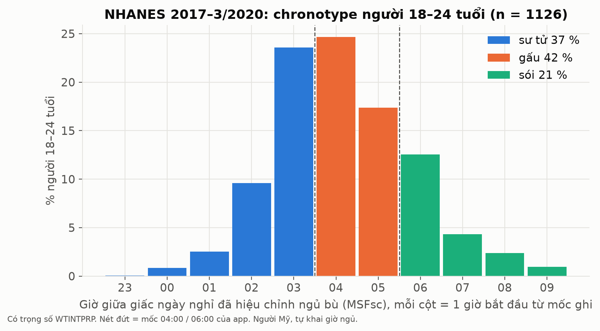
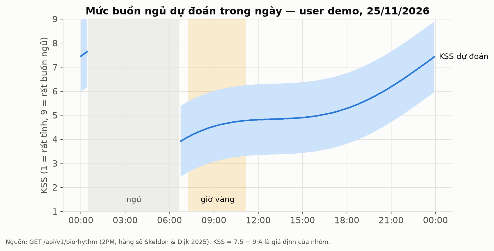
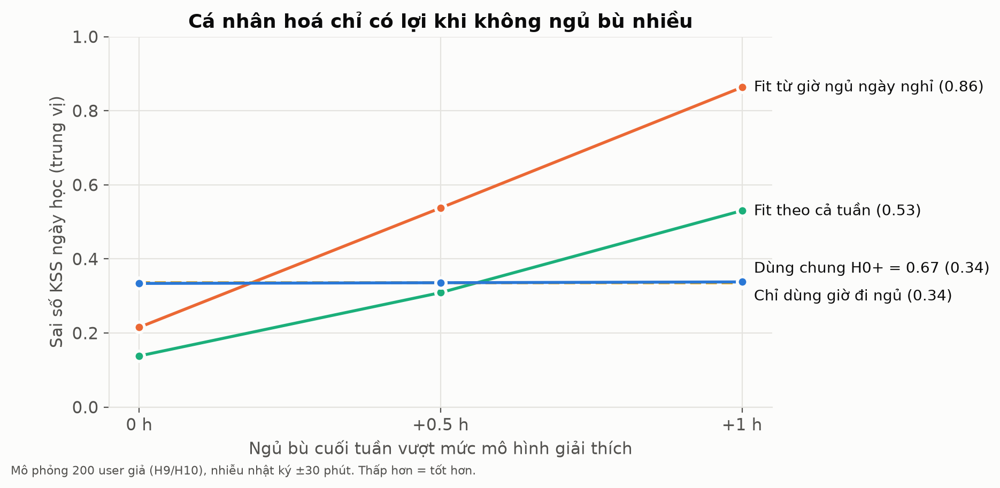

# Mô hình giấc ngủ — công thức, số liệu và nguồn

> Owner: Backend — Member 1 (R18–R20, H7, H8). Ghi ngày 2026-11-25, theo code trên `main` (`server/app/service/sleep/`, `server/app/service/biorhythm_service.py`).
> Hình trong `docs/figures/` được tạo bằng script ở workspace nghiên cứu (`src/make_figures.py`, matplotlib), từ đúng số liệu ghi trong tài liệu này.
> Mục đích: mỗi công thức và hằng số trong app đều ghi rõ **lấy từ đâu** và **đã kiểm chứng tới mức nào**, để báo cáo đồ án trung thực về mặt khoa học.

## 0. Cách đọc cột "Kiểm chứng"

| Ký hiệu | Nghĩa |
|---|---|
| ✅ **Toàn văn** | Đã đọc toàn văn bài báo và đối chiếu đúng số / đúng mục (ghi số trang, hình, phương trình) |
| ☑️ **Dữ liệu** | Đã tự phân tích trên dữ liệu công khai (NHANES), có script tái lập |
| 📄 **Trích dẫn** | Code có trích nguồn nhưng **chưa đọc toàn văn** trong đợt kiểm chứng này — cần đọc trước khi đưa vào báo cáo |
| ⚠️ **Giả định nhóm** | Không có nguồn; nhóm tự chọn. Phải ghi là giả định khi trình bày |

Nhật ký kiểm chứng chi tiết (protocol, kết quả, mô phỏng): workspace nghiên cứu riêng `~/Documents/Recolly-research` (`findings.md`, `experiments/`). Quyết định giữ/đổi do Member 1 sign-off; tài liệu này chỉ ghi bằng chứng.

## 1. Tổng quan luồng tính

```
Quiz µMCTQ (4 mốc giờ) ──► MSFsc ──► φ (pha nhịp sinh học) ──┐
Log ngủ (sleep-logs) ────────────────────────────────────────┼──► Mô hình 2 quá trình (Process S + C)
                                                             │        └─► mức tỉnh táo A(t) ─► KSS(t) ─► giờ vàng ─► CP-SAT xếp lịch
Log ngủ + nhu cầu ngủ ───────────────────────────────────────┴──► Nợ ngủ (phép trừ, không dùng 2PM)
```

## 2. Mô hình hai quá trình (2PM) — `two_process.py`

### 2.1 Phương trình

| Công thức | Nguồn | Kiểm chứng |
|---|---|---|
| Thức: `H(t+Δ) = μ + (H(t) − μ)·e^(−Δ/χw)` | Skeldon & Dijk 2025, Methods tr. 11, pt. (10), (13) | ✅ Toàn văn |
| Ngủ: `H(t+Δ) = H(t)·e^(−Δ/χs)` | Skeldon & Dijk 2025, pt. (11), (14) | ✅ Toàn văn |
| Ngưỡng: `H±(t) = H0± + a·C(t)`; thức → ngủ khi `H ≥ H+`, ngủ → thức khi `H ≤ H−` | Skeldon & Dijk 2025, pt. (7), (8), (15), (16) | ✅ Toàn văn |
| `C(t) = cos(2π(t − φ)/24)` | Skeldon & Dijk 2025 tr. 11: "In its simplest form C(t) is often taken to be sinusoidal, C(t) = cos ωt" | ✅ Toàn văn |
| Kiểm tra: khi `a = 0`, `Tsleep = χs·ln(H0+/H0−)`, `Twake = χw·ln((μ − H0−)/(μ − H0+))` | Skeldon & Dijk 2025 pt. (2), (3), tr. 5: "Tsleep = 5.8 h, Twake = 16.8 h … Tnat = 22.6 h" | ✅ Code ra 5.76 / 16.79 / 22.55 h |

Ghi chú: code dùng nghiệm chính xác của phương trình trên mỗi bước 5 phút (`STEP_HOURS = 5/60`). Bước 5 phút làm mỗi lần chuyển ngủ/thức trễ tối đa 5 phút (mô phỏng ra Twake 16.92 h thay vì 16.79 h) — sai số do lưới thời gian, không phải do hằng số.

### 2.2 Hằng số (`Params`)

| Hằng số | Giá trị | Nguồn | Kiểm chứng |
|---|---|---|---|
| `chi_s` (χs, hằng số thời gian khi ngủ) | 4.2 h | Skeldon & Dijk 2025, chú thích Hình 1 (tr. 2) và tr. 8: "Typical values … reported as 18.2 h and 4.2 h" (gốc: Daan, Beersma & Borbély 1984) | ✅ Toàn văn |
| `chi_w` (χw, khi thức) | 18.2 h | như trên | ✅ Toàn văn |
| `mu` (μ, tiệm cận trên) | 1.0 | Skeldon & Dijk 2025, Hình 1; dạng không thứ nguyên của Daan 1984 (μs = 0, μ = 1), tr. 11 | ✅ Toàn văn |
| `h0_upper` (H0+) | 0.67 | Skeldon & Dijk 2025, Hình 1. Nguồn phụ: Horm Behav 2013 Fig. 2 — "parameters optimized to fit the sleep patterns of young adults (Daan et al., 1984)" | ✅ Toàn văn |
| `h0_lower` (H0−) | 0.17 | như trên | ✅ Toàn văn |
| `amplitude` (a) | 0.12 | như trên. Lưu ý: Skeldon et al. 2014 Hình 1 dùng a = 0.10 **chỉ để minh hoạ** | ✅ Toàn văn |
| `period` | 24 h | Skeldon & Dijk 2025, tr. 2 (nhịp sinh học đồng bộ 24 h) | ✅ Toàn văn |
| `phi` (φ) mặc định | 16.0 | Giá trị giữ chỗ; luôn bị thay bằng φ của từng user (mục 3) | ⚠️ Không ảnh hưởng kết quả |

Bài gốc Daan, Beersma & Borbély 1984 (*Am J Physiol* 246:R161–R183) **chưa đọc**; các số trên lấy qua Skeldon & Dijk 2025 (đồng tác giả Dijk, viết nhân kỷ niệm 41 năm bài 1984).

Độ nhạy (mô phỏng, đổi ±10 % từng hằng số): H0+ ảnh hưởng mạnh nhất (giấc ngủ ±0.7 h, giờ giữa giấc ±1.2 h) > χw > χs > H0− > a. Skeldon & Dijk 2025 tr. 7 cũng ghi biên độ "has minimal change in the percentage of time spent asleep".



### 2.3 Những gì **không** đưa vào mô hình

| Quyết định | Bằng chứng | Kiểm chứng |
|---|---|---|
| Không thêm Process W (quán tính giấc ngủ) | Ingre et al. 2014, Results "Validating the TPM": W "provided a much worse fit … default parameters of process W were exaggerated" | ✅ Toàn văn (phương trình trong bài là ảnh, chưa đọc được) |
| Không thêm Process U (nhịp 12 h) | Ingre et al. 2014: khi pha C đã chỉnh theo chronotype thì mô hình không có U khớp tốt hơn; "process U was part of the model only to adjust some of the misfit from the original process C" | ✅ Toàn văn |
| Chronotype chỉ dịch pha φ | Ingre et al. 2014: pha theo tự đánh giá 14.61 / 15.28 / 15.95 / 16.62 h (sáng → rất tối), ~0.67 h mỗi bậc. **Lưu ý ngược lại:** Skeldon & Dijk 2025 tr. 6 ghi người dậy sớm / ngủ muộn còn khác nhau về *góc pha* giữa giấc ngủ và nhịp sinh học → app dùng chung một độ lệch cho mọi người là xấp xỉ (đang nghiên cứu) | ✅ Toàn văn |

Ingre 2014 dùng mô hình 3 quá trình (TPM) của Åkerstedt/Folkard, không phải 2PM của Borbély → chỉ dùng làm bằng chứng về **cấu trúc**, không lấy hằng số. Đối tượng là phi công/tiếp viên, không phải sinh viên.

## 3. Pha φ của từng user

Hiện tại φ **chỉ lấy từ quiz** (`biorhythm_service.phi_prior`; `model_summary` trả `personalization_level: "prior_only"`). Log ngủ chỉ điều khiển Process S (đêm nào ngủ bao lâu), **chưa** dùng để cập nhật φ.

| Công thức / hằng số | Giá trị | Nguồn | Kiểm chứng |
|---|---|---|---|
| `φ = (MSFsc + offset) mod 24`, `offset = φ − giờ giữa giấc khi chạy tự do` (`mid_sleep_offset`) | offset ≈ 12.42 h | Suy ra từ chính 2PM (mô hình bất biến khi dịch thời gian) | ✅ Tự kiểm bằng mô phỏng (12.41 h) |
| ~~`MCTQ_PHI_BIAS_HOURS`~~ — từng cộng +0.9 h vào φ khi φ tính từ MCTQ | **đã bỏ** (25/11/2026) | Chỉ từ một thí nghiệm mô phỏng cũ của nhóm, không có nguồn | ❌ Đã xoá khỏi code: φ = φ(MSFsc) |
| `PHI_SD_HOURS` / `PHI_SD_UNCERTAIN_HOURS` / `PHI_SD_DISAGREEMENT_HOURS` | 1.0 / 1.5 / 0.5 h | — | ⚠️ Giả định nhóm |
| `ANIMAL_MID_SLEEP` (khi chỉ có rMEQ hoặc tự chọn con vật) | 03:00 / 05:00 / 07:00 | — | ⚠️ Giả định nhóm |
| `PRIOR_NIGHTS` — quiz nặng bằng 7 đêm thật khi cập nhật φ bằng log ngủ ngày nghỉ (`chronotype.estimate`) | 7 | — | ⚠️ Giả định nhóm — **có trong code nhưng API chưa gọi** |
| `CHI_W_PRIOR` | (18.2, SD 2.5) h | Trung bình theo mục 2.2; SD do nhóm chọn | ✅ / ⚠️ |

## 4. Quiz µMCTQ — `mctq.py`

| Công thức | Nguồn | Kiểm chứng |
|---|---|---|
| `SDw`, `SDf` = thời lượng ngủ ngày học / ngày nghỉ; `MSW`, `MSF` = giờ giữa giấc | Roenneberg, Wirz-Justice & Merrow 2003 (MCTQ) | 📄 Trích dẫn |
| `SDweek = (SDw·ngày_học + SDf·(7 − ngày_học)) / 7` | Roenneberg et al. (MCTQ) | 📄 Trích dẫn |
| `MSFsc = MSF − (SDf − SDweek)/2` nếu `SDf > SDw`, ngược lại `MSFsc = MSF` | Roenneberg et al. (MCTQ) | 📄 Trích dẫn |
| Social jetlag `= abs(MSF − MSW)` (tính trên vòng 24 h) | Wittmann et al. 2006 | 📄 Trích dẫn |
| rMEQ 5 câu, tổng 4–25; ngưỡng 22 / 18 / 12 / 8 | Adan & Almirall 1991 | 📄 Trích dẫn |
| Cờ "dolphin": ≥ 3 đêm/tuần trong ≥ 3 tháng | DSM-5 (tiêu chuẩn tần suất/thời gian mất ngủ) | 📄 Trích dẫn |
| Con vật theo MSFsc: sư tử < 04:00, gấu 04:00–06:00, sói ≥ 06:00 | — (chỉ để hiển thị; mô hình dùng φ liên tục) | ⚠️ Giả định nhóm, **có kiểm trên dữ liệu**: NHANES 2017–3/2020, 18–24 tuổi (n = 1126, có trọng số): MSFsc trung vị 04:30; sư tử 37 % / gấu 42 % / sói 21 % ☑️ |
| Thang 5 mức (spectrum) 03:00 / 04:30 / 05:30 / 06:30 | — | ⚠️ Giả định nhóm |
| rMEQ → con vật: ≥ 18 sư tử, ≥ 12 gấu, còn lại sói | — | ⚠️ Giả định nhóm |



## 5. Mức tỉnh táo, KSS và giờ vàng — `two_process.py`, `timeline.py`

| Công thức / hằng số | Giá trị | Nguồn | Kiểm chứng |
|---|---|---|---|
| Thang KSS (Karolinska Sleepiness Scale): 9 mức, 1 = "extremely alert" … 5 = "neither alert nor sleepy" … 9 = "very sleepy, great effort to keep awake, fighting sleep"; chấm cho **10 phút vừa qua**; bản sửa đổi có thêm mức 10 | 1–9 | Åkerstedt & Gillberg 1990 (bài gốc); mô tả và bảng đầy đủ: Shahid et al. 2012, chương 47, tr. 209–210. Độ hiệu lực: "highly correlated to EEG and behavioral variables" (Kaida et al. 2006, theo chương sách) | ✅ Toàn văn chương sách; 📄 bài gốc 1990 và Kaida 2006 chưa đọc |
| Mức tỉnh táo `A(t) = H+(t) − H(t)` (khoảng cách tới ngưỡng ngủ) | — | Định nghĩa của nhóm dựa trên 2PM | ⚠️ Giả định nhóm |
| `KSS = 7.5 − 9·A` | 7.5, 9 | Không có nguồn. Ingre 2014 có công thức tuyến tính cùng dạng (`KSS ≈ 9.68 − 0.46·score`) nhưng cho thang của TPM, **không chuyển sang 2PM được**. Hệ quả: KSS lúc bắt đầu ngủ luôn = 7.5 (vì A = 0) | ⚠️ Giả định nhóm — chưa hiệu chỉnh |
| Điểm tỉnh táo UI `= 100·(9 − KSS)/8` | — | Đổi thang tuyến tính | ⚠️ Quy ước hiển thị |
| `KSS_SIGMA` (dải ±1.96σ) | 0.75 (±1.47) | — | ⚠️ Giả định nhóm |
| Giờ vàng = các bước đang thức có KSS ≤ phân vị 25 % của ngày, dài ≥ 30 phút (`MIN_WINDOW_STEPS`) | — | — | ⚠️ Giả định nhóm |
| Bỏ 30 phút đầu sau khi dậy (`INERTIA_STEPS = 6`) | 30 phút | Lý do: 2PM không mô hình hoá quán tính (`typical_week.py` trích Van Dongen et al. 2007, Discussion). Ingre 2014: quán tính thật "much smaller" so với mặc định của TPM | 📄 Trích dẫn — Tassi & Muzet 2000, Jewett et al. 1999 chưa đọc |
| Khoảng đệm tuần mẫu: sau khi dậy 0.5 h, trước khi ngủ 1 h, khối đỉnh 1.5 h (`typical_week.py`; `energy.py` có bản sao nhưng **API chưa gọi** `day_energy`) | — | — | ⚠️ Giả định nhóm |

**Bản quyền thang KSS:** chương sách ghi "Copyright © Torbjörn Åkerstedt, 1990 … Reproduction, duplication or adaptation without the written consent of Torbjörn Åkerstedt is strictly prohibited." Nếu app hiển thị nguyên văn 9 mức (màn tự chấm KSS), cần xin phép tác giả hoặc chỉ hiển thị số 1–9 kèm mô tả tự viết, và ghi nguồn. App hiện chưa có màn này.



*User demo với giờ ngủ giả (script `server/scripts/demo_sleep_flow.py`), dữ liệu lấy từ `GET /api/v1/biorhythm`, không phải người thật.*

## 6. Nợ ngủ — `debt.py`, `biorhythm_service.debt_summary`

| Công thức / hằng số | Giá trị | Nguồn | Kiểm chứng |
|---|---|---|---|
| `Nợ = Σ (nhu cầu − giờ ngủ thật)` trên 7 đêm gần nhất; tổng không âm | — | Phép trừ trực tiếp, cố ý **không** dùng 2PM vì 2PM tính thiếu khi thiếu ngủ kéo dài (Van Dongen et al. 2007, trích trong code) | 📄 Trích dẫn |
| Nhu cầu ngủ = số user nhập, mặc định | 8.0 h | NHANES 2017–3/2020, 18–24 tuổi: trung bình cả tuần (5·ngày thường + 2·cuối tuần)/7 = 8.28 h (tự khai, có thể cao hơn thực tế) | ☑️ Dữ liệu |
| Kẹp nhu cầu trong 7–10 h | 7 h | Watson et al. 2015, *Sleep* 38(6) — người lớn cần ít nhất 7 h | 📄 Trích dẫn |
| | 10 h | — | ⚠️ Giả định nhóm |

Lưu ý: `sleep_need()` chỉ nhận số user nhập (`sleep_need_hours`, mặc định 8.0 h). Nhánh cũ lấy thời lượng ngủ ngày nghỉ trong quiz làm nhu cầu **đã bị xoá** (25/11/2026) vì: NHANES cho thấy người 18–24 tuổi ngủ bù cuối tuần trung bình 0.71 h (25 % bù ≥ 2 h), nên lấy giờ ngủ ngày nghỉ làm nhu cầu sẽ tạo "nợ ảo" khoảng 5 × 0.71 ≈ 3.5 h/tuần.

## 7. Lời khuyên hiển thị — `advice.py`

Các câu khuyên trích nguồn ngay trong code: Watson et al. 2015 (*Sleep* 38(6)), Phillips et al. 2017 (*Sci Rep* 7, doi:10.1038/s41598-017-03171-4), Facer-Childs et al. 2019 (*Sleep Med* 60, doi:10.1016/j.sleep.2019.05.001), Goldin et al. 2020 (*Nat Hum Behav* 4, doi:10.1038/s41562-020-0820-2), Sleep Foundation (trang phổ thông). Tất cả: 📄 Trích dẫn — chưa đối chiếu toàn văn trong đợt này.

## 8. Đã thử nhưng **không** đưa vào app (mô phỏng, 200 user giả)

| Thử | Kết quả | Kết luận |
|---|---|---|
| Fit H0+ riêng từng người từ thời lượng ngủ ngày nghỉ | Sai số KSS ban ngày 0.33 → 0.14 nếu không ngủ bù; nhưng ngủ bù ≥ 0.5 h thì **tệ hơn** dùng chung | Giữ H0+ chung |
| Fit (H0+, φ) theo cả tuần có báo thức | 0.14; chịu được ~0.5 h ngủ bù ngoài mô hình, 1 h thì thua | Lợi tối đa ~0.2 KSS, nhỏ hơn dải ±1.47 của app |
| Chỉ dùng giờ đi ngủ | Không hơn dùng chung | Giờ đi ngủ không tách được H0+ và φ |



Dữ liệu thật (NHANES 18–24): ngủ bù cuối tuần 0.71 h — đúng vùng mà cá nhân hoá hết lợi. Cá nhân hoá nên làm sau, khi có KSS tự chấm trong ngày.

## 9. Tài liệu tham khảo

Đã đọc toàn văn / tự phân tích:
1. Skeldon AC, Dijk D-J (2025). The complexity and commonness of the two-process model of sleep regulation from a mathematical perspective. *npj Biological Timing and Sleep* 2:24. [doi:10.1038/s44323-025-00039-z](https://doi.org/10.1038/s44323-025-00039-z) (CC BY 4.0)
2. Skeldon AC, Dijk D-J, Derks G (2014). Mathematical models for sleep-wake dynamics: comparison of the two-process model and a mutual inhibition neuronal model. *PLoS ONE* 9(8): e103877. [arXiv:1311.1734](https://arxiv.org/abs/1311.1734)
3. Ingre M, Van Leeuwen W, Klemets T, Ullvetter C, Hough S, Kecklund G, Karlsson D, Åkerstedt T (2014). Validating and extending the three process model of alertness in airline operations. *PLoS ONE* 9(10): e108679. [doi:10.1371/journal.pone.0108679](https://doi.org/10.1371/journal.pone.0108679)
4. *Hormones and Behavior* 64(2):270–279 (2013), Fig. 2 (chú thích về tham số Daan 1984). [doi:10.1016/j.yhbeh.2013.01.013](https://doi.org/10.1016/j.yhbeh.2013.01.013) — chỉ đọc chú thích hình
5. CDC/NCHS. NHANES 2017–March 2020 Pre-Pandemic: [P_SLQ](https://wwwn.cdc.gov/Nchs/Data/Nhanes/Public/2017/DataFiles/P_SLQ.htm) (Sleep Disorders), P_DEMO (Demographics). Phân tích có trọng số `WTINTPRP`; kiểm tra: cả nhóm 18+ ra 7.61 / 8.26 h, khớp số đã công bố 7.59 / 8.24 h
6. Shahid A, Wilkinson K, Marcu S, Shapiro CM (eds.) (2012). Karolinska Sleepiness Scale (KSS). In *STOP, THAT and One Hundred Other Sleep Scales*, ch. 47, pp. 209–210. Springer. [doi:10.1007/978-1-4419-9893-4_47](https://doi.org/10.1007/978-1-4419-9893-4_47)

Chưa đọc toàn văn (trích trong code, hoặc qua nguồn thứ cấp):
7. Daan S, Beersma DGM, Borbély AA (1984). Timing of human sleep: recovery process gated by a circadian pacemaker. *Am J Physiol* 246:R161–R183
8. Borbély AA et al. (2016). The two-process model of sleep regulation: a reappraisal. *J Sleep Res* (link trong README)
9. Roenneberg T, Wirz-Justice A, Merrow M (2003). Life between clocks: daily temporal patterns of human chronotypes. *J Biol Rhythms* (MCTQ)
10. Wittmann M et al. (2006). Social jetlag. *Chronobiol Int*
11. Adan A, Almirall H (1991). Horne & Östberg morningness-eveningness questionnaire: a reduced scale (rMEQ)
12. Watson NF et al. (2015). Recommended amount of sleep for a healthy adult. *Sleep* 38(6)
13. Van Dongen HPA et al. (2007) — như trích trong `typical_week.py`
14. Tassi P, Muzet A (2000). Sleep inertia. *Sleep Med Rev*; Jewett ME et al. (1999). *J Sleep Res* — về quán tính giấc ngủ
15. Åkerstedt T, Gillberg M (1990). Subjective and objective sleepiness in the active individual. *Int J Neurosci* 52:29–37. [doi:10.3109/00207459008994241](https://doi.org/10.3109/00207459008994241)
16. Kaida K et al. (2006). Validation of the Karolinska sleepiness scale against performance and EEG variables. *Clin Neurophysiol* 117:1574–1581

## 10. Việc còn mở

- [ ] Bản quyền thang KSS trước khi làm màn tự chấm KSS (xin phép Åkerstedt hoặc dùng mô tả tự viết).
- [ ] Đọc toàn văn các nguồn 📄 (ưu tiên: MCTQ Roenneberg 2003 cho công thức MSFsc; Tassi & Muzet / Jewett cho 30 phút).
- [x] `MCTQ_PHI_BIAS_HOURS = 0.9`: không tìm được nguồn → đã bỏ (25/11/2026).
- [ ] `KSS = 7.5 − 9·A`: hiệu chỉnh khi có KSS tự chấm thật.
- [ ] Góc pha theo chronotype (Skeldon & Dijk 2025 tr. 6; Duffy et al. 1999 chưa đọc).
- [ ] Mốc con vật: fit lại trên dữ liệu sinh viên Việt Nam.
