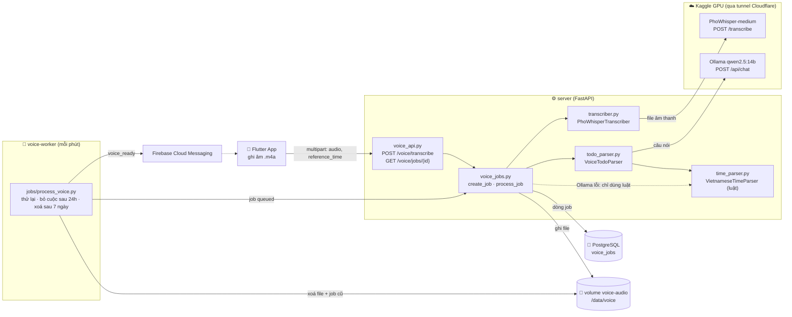
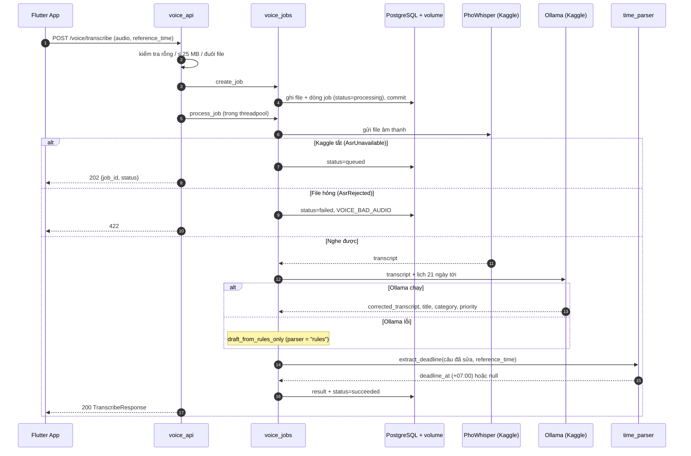
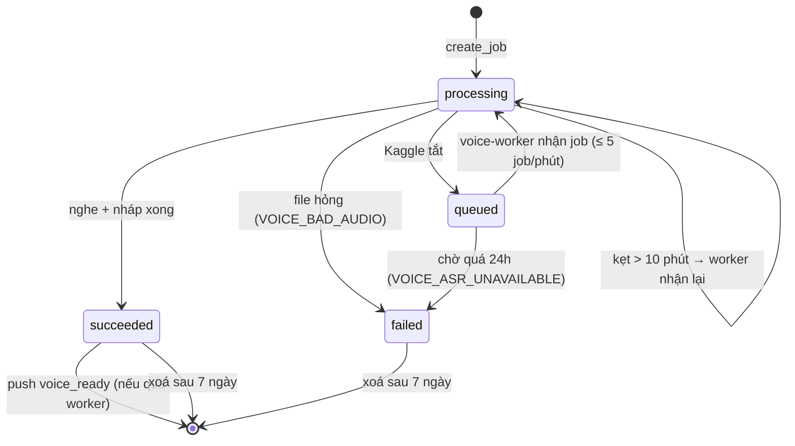

# Pipeline giọng nói → todo — kiến trúc

> Owner: Backend — Member 1 (R42, R43). Phía Flutter: Member 2 (R41, R44).
> Ghi ngày 2026-11-23, theo code trên `main`. Hợp đồng API: `V1 POST /voice/transcribe`, `V2 GET /voice/jobs/{id}` trong [`openapi.yaml`](openapi.yaml).

## 1. Tóm tắt

1. **Lưu ghi âm trước, xử lý sau.** File âm thanh và một dòng `voice_jobs` được commit trước khi gọi Kaggle, nên Kaggle tắt cũng không mất ghi âm.
2. **ASR + LLM chạy trên Kaggle GPU**, server gọi qua 2 tunnel Cloudflare (PhoWhisper-medium và Ollama `qwen2.5:14b`).
3. **Deadline do luật tính, không do LLM.** LLM chỉ sửa lỗi nghe, đặt tên, chọn category/priority; `VietnameseTimeParser` đọc ngày giờ từ câu đã sửa.
4. **Server không tự lưu todo.** Nó trả về bản nháp (`todo_draft`); app cho người dùng xác nhận rồi mới gọi API todo.
5. **Kaggle tắt → 202 + hàng đợi.** `voice-worker` thử lại mỗi phút, xong thì push `voice_ready` qua FCM.

## 2. Sơ đồ thành phần

## 3. Một request đi qua những bước nào

Khi nhận 202, app hỏi lại `GET /voice/jobs/{job_id}` hoặc chờ push `voice_ready`.

## 4. Trạng thái của một voice job

## 5. Ai làm gì

| Bước | File | Ghi chú |
|---|---|---|
| Nhận file, kiểm tra | `server/app/api/voice_api.py` | Tối đa 25 MB; chỉ `.m4a .mp4 .aac .wav .ogg .mp3` được giữ đuôi |
| Lưu + xử lý job | `server/app/service/voice/voice_jobs.py` | Commit trước khi gọi Kaggle; log chỉ ghi độ dài câu, không ghi nội dung |
| Speech-to-text | `server/app/service/voice/transcriber.py` | `ASR_BASE_URL`, `ASR_TOKEN`, timeout 120s |
| Sửa câu + nháp todo | `server/app/service/voice/todo_parser.py` | `VOICE_LLM_MODEL` (mặc định `qwen2.5:14b`), `VOICE_REPAIR_TRANSCRIPT=1` |
| Đọc ngày giờ | `server/app/service/voice/time_parser.py` | "tối thứ sáu", "chiều mai", "9 giờ tối" → giờ +07:00; chỉ có ngày → 23:59 |
| Thử lại, push, dọn dẹp | `server/app/jobs/process_voice.py` | Service `voice-worker` trong `docker-compose.yml` |

## 6. Số liệu đo thật (2026-11-23, 14 lần gửi)

| | ASR | LLM | Tổng |
|---|---|---|---|
| Câu ngắn (27–107 ký tự) | 1.4–3.5s | 3.7–5.2s | 5–9s |
| Đoạn văn (121–258 ký tự) | 3–5s | 4–6s | 7–11s |
| Đoạn dài (696 ký tự) | 15.6s | 10.3s | 26s |
| Lần đầu (Kaggle chưa nóng) | 10.4s | 7.4s | 18s |

LLM là phần chậm nhất. Xem log từng bước trong Dozzle (container `recolly-server-container`, `recolly-voice-worker-container`).

## 7. Giới hạn đã biết

- `estimated_minutes` và `difficulty` luôn `null`: chưa có bước nào trích "hai tiếng", "một tiếng rưỡi".
- Câu không phải lệnh (đọc một đoạn văn) vẫn sinh ra `todo_draft`.
- Tên todo đôi khi lấy nguyên câu lệnh ("Đặt Lịch Học"), viết hoa không thống nhất.
