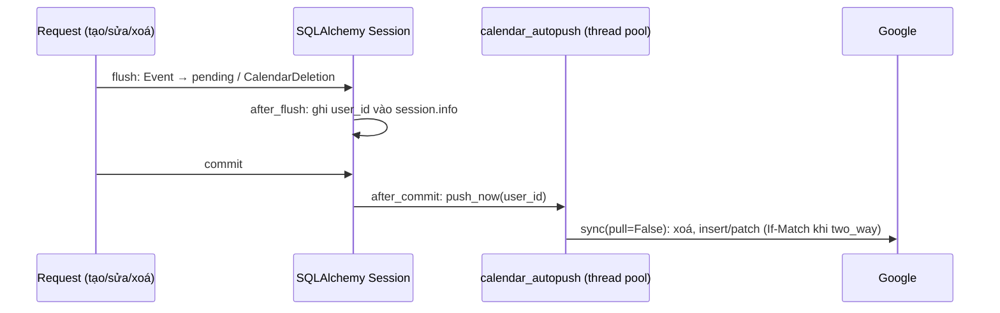
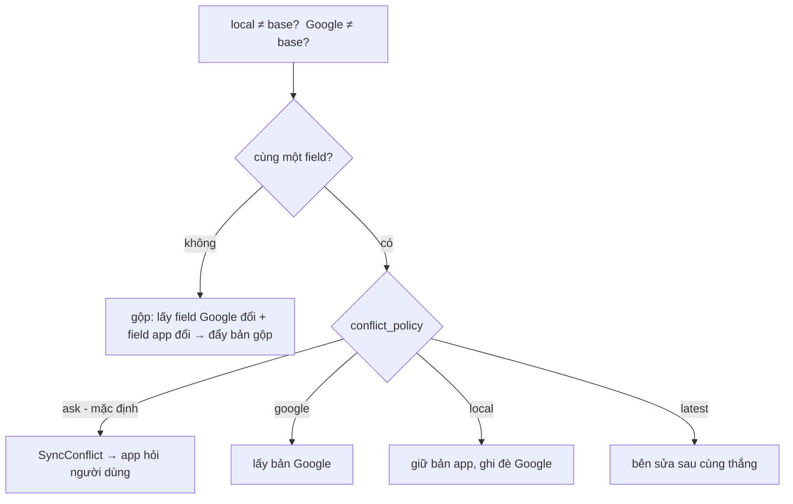

# Luồng đồng bộ Google Calendar (R30, R31, R45) — thiết kế 2026-11-28

Code: `app/service/calendar_sync.py` (push/pull/merge), `calendar_autopush.py` (tự đẩy),
`schedule_guard.py` (trùng giờ), `app/api/calendar_api.py`, job `app/jobs/calendar_maintenance.py`.

**Nguyên tắc**
1. PostgreSQL là nguồn chính. Google chỉ là nơi hiển thị và nơi người dùng có thể sửa.
2. Người dùng chọn chế độ sync. App không tự bật hai chiều thay người dùng.
3. Có hai loại "conflict" khác nhau và được xử lý riêng:
   - **Sửa trùng**: cùng một event bị sửa ở cả app lẫn Google.
   - **Trùng giờ**: hai lịch đè lên nhau.
4. Lịch cá nhân trên Google **không bị copy về DB**. App chỉ đọc *giờ bận* khi cần, để xếp lịch và cảnh báo.

## 1. Chế độ sync (`PATCH /calendar/settings {sync_mode}`)

| `sync_mode` | App → Google | Google → app | Webhook |
|---|---|---|---|
| `off` | – (thay đổi vẫn ở `pending`, bật lại thì đẩy hết) | – | tắt |
| `push` *(mặc định)* | tự động sau mỗi thay đổi | chỉ đọc giờ bận | tắt |
| `two_way` | tự động | kéo các sửa đổi trên lịch đích + đọc giờ bận | bật |

- `two_way_sync` (kiểu boolean) vẫn được nhận và vẫn trả về, nhưng đã **deprecated**: `true` tương ứng `two_way`, `false` tương ứng `push`.
- `POST /calendar/sync` khi đang ở `off` trả 409 `CALENDAR_SYNC_OFF`.

## 2. Lịch đích: lịch riêng "Recolly"

- Khi kết nối, nếu Google cấp scope `https://www.googleapis.com/auth/calendar.app.created`, server gọi `calendars.insert`
  để tạo lịch **"Recolly"** và ghi mọi thứ vào đó. Người dùng có thể ẩn hiện hoặc xoá cả lịch này,
  và lịch cá nhân không bị lẫn vào.
- Nếu chưa được cấp scope đó thì ghi vào `primary` như trước.
- Ngắt kết nối thì **xoá lịch "Recolly"** (`calendars.delete`, scope đó cho phép), để kết nối lại không sinh ra lịch thứ hai.
  Lịch người dùng tự chọn (G8) thì Google không cho app xoá (403), nên luôn được giữ lại.
- Nguồn: Google Calendar API, trang *Choose Google Calendar API scopes* (developers.google.com/workspace/calendar/api/auth)
  và trang reference `calendars.insert` / `freebusy.query`. Trang không ghi ngày cập nhật; đọc ngày 2026-11-28.

## 3. Tự đẩy (app → Google)



- Một chỗ duy nhất (event listener) nên mọi API tạo hoặc sửa event đều được đẩy, không phải nhớ gọi ở từng nơi.
- Phiên push tự đánh dấu `gcal_pushing`, nên lỗi Google (event thành `error`) không gây vòng lặp đẩy lại.
- Nếu push lỗi, thay đổi vẫn ở `pending`/`error`. Nút "Đồng bộ ngay" (`POST /calendar/sync`) dùng để thử lại.

## 4. Sửa trùng: merge ba bên + chính sách

Mỗi event lưu `synced_snapshot`, là bản mà cả hai bên thống nhất ở lần sync gần nhất (base).
Khi event bị sửa ở cả hai phía (lúc pull, hoặc khi push bị Google trả 412):



Các field được so sánh: title, description, location, start_at, end_at, all_day, rrule.
Ví dụ: app đổi tên, còn Google đổi phòng thì hai thay đổi được gộp lại, không phát sinh conflict.

## 5. Trùng giờ

| Loại | Dời được? |
|---|---|
| Lịch học, event tự tạo, todo có giờ cố định, event từ Google, giờ bận trên Google | Cố định |
| Khối học/nghỉ do CP-SAT xếp (`source = scheduler`) | **Dời được** |

- Khi tạo hoặc sửa event/todo (E2, E4, D2, D4), và khi kéo về một event mới hoặc vừa bị dời trên Google:
  - Khối CP-SAT bị đè thì **bị xoá và được CP-SAT xếp lại** trong 14 ngày tới. Response trả về chúng trong `rescheduled`.
  - Các thứ cố định bị đè thì trả về trong `clashes`. App hỏi người dùng: giữ cả hai, dời, hay bỏ.
- Event lặp được kiểm tra trùng giờ trong 14 ngày tới. Event cả ngày không bao giờ tính là trùng.
- Giờ bận trên Google lấy bằng `events.list` (singleEvents) trên `primary`. Chỉ đọc giờ và tiêu đề, bỏ qua event
  của chính Recolly, bỏ qua event đánh dấu `transparent` (hiện là "rảnh"), và không lưu gì.
  Cách này chạy được với scope `calendar.events` hiện có (`freebusy.query` thì cần scope khác).
- `POST /schedule/generate` cũng tránh các giờ bận này.
- Một lần pull có nhiều event đè lên khối học thì chỉ chạy **một** lần CP-SAT cho tất cả (`schedule_guard.make_room`).
- Khi push bị Google trả 412, server merge rồi **đẩy lại ngay một lần** với etag mới.

## 6. Todo nào thành event

| Todo | Event? |
|---|---|
| Không giờ, không deadline | Không |
| Có deadline (+ ước tính) | Không. CP-SAT tạo *khối học* trước deadline; nhắc deadline bằng thông báo (R39) |
| Có giờ cố định (`start_at`/`end_at`) | Có, 1 event (kind `other`, `todo_id`), có kiểm tra trùng giờ |

Đổi tên todo thì các khối học đổi tên theo. Todo xong hoặc bị xoá thì event giờ cố định của nó bị xoá, khối học vẫn giữ.

## 7. Hai chiều: các trường hợp đặc biệt

- Một buổi của chuỗi lặp bị dời hoặc huỷ trên Google: lưu vào `event_exceptions`, và chuỗi bỏ qua buổi đó.
  Buổi bị dời thành một event riêng.
- Cả chuỗi lịch học bị dời trên Google: Subject trong thời khoá biểu đổi theo (tên, phòng, thứ, giờ).
- Kênh webhook sống khoảng 7 ngày. Service `calendar-maintenance` chạy mỗi ngày để gia hạn kênh, và kéo dự phòng khi không còn kênh.
- Dev: `WEBHOOK_BASE_URL` phải là URL public (ngrok, hoặc `docker compose --profile tunnel up`).

## 8. Schema và API (báo cả team)

- DB: `calendar_connections.sync_mode`, `conflict_policy` (bỏ `two_way_sync`); `events.synced_snapshot`;
  bảng `event_exceptions`. Các thay đổi này được áp dụng tự động lúc server khởi động (`app/db/upgrade.py`, idempotent).
- API (chỉ **thêm**, không bỏ gì): `CalendarStatus.sync_mode/conflict_policy`; `CalendarSettingsUpdate.sync_mode/conflict_policy`;
  E2/E4 trả `EventSaved` (`clashes`, `rescheduled`); D2/D4 trả `TodoSaved`; `ScheduleBlock.focus/window`;
  D2 điền `difficulty` theo category khi app gửi null; PushPayload có thêm `type = event_start`
  (nhắc 15 phút trước khối học / todo có giờ). `docs/openapi.yaml` **chưa cập nhật**.

## Xem khi chạy

```bash
docker compose logs -f server | grep -iE "GCal|Auto push|webhook"
docker compose logs calendar-maintenance
```

## Giới hạn đã biết

- Tự đẩy dùng thread pool trong tiến trình server. Server khởi động lại thì việc đang chờ mất, nhưng event vẫn `pending` cho lần sync sau.
- Dời khối học dùng `ScheduleOptions` mặc định, không dùng tuỳ chọn mà người dùng chọn lúc xếp lịch.
- Đổi `UNTIL` của chuỗi trên Google không làm đổi `end_date` của môn học. Sửa event của todo trên Google không làm đổi todo.
- Todo đã có từ trước bản này mà chưa có `difficulty` thì scheduler dùng giá trị mặc định theo category (không ghi vào DB).
